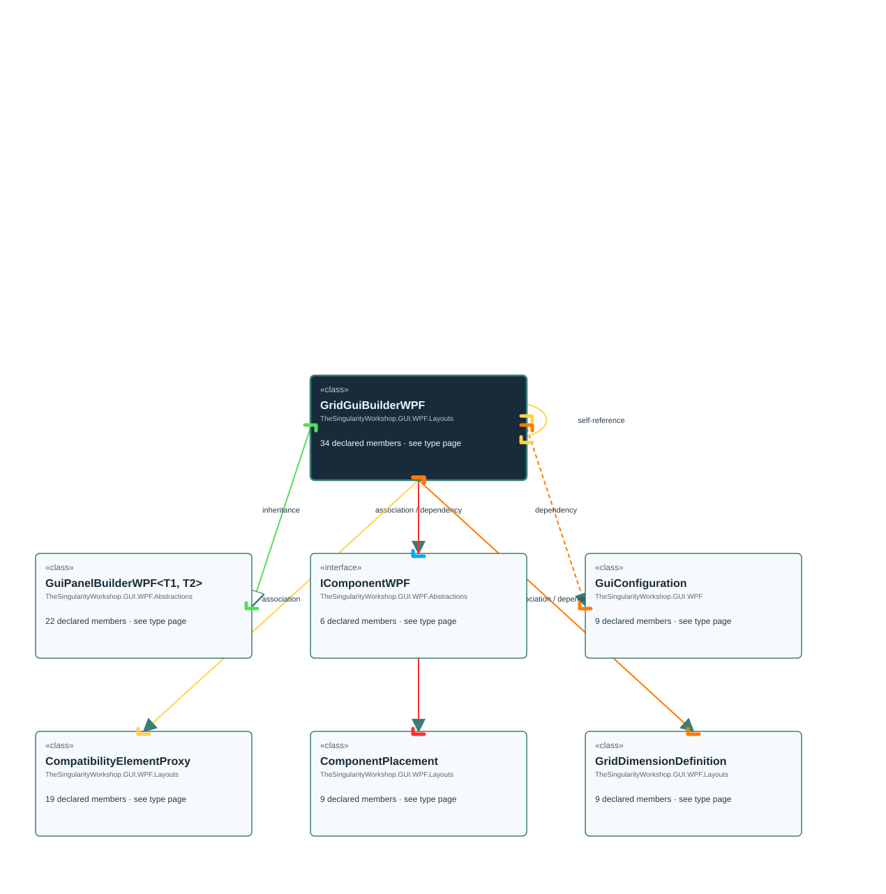

<!-- The Singularity Workshop moniker -->

# TheSingularityWorkshop.GUI.WPF.Layouts.GridGuiBuilderWPF

> Generated from compiler-backed source analysis. Do not edit by hand.

- Repository: `TrentBest/TheSingularityWorkshop.GUI`
- Revision: [`f48dd15256521c88fad88371742c89d5fd1d326f`](https://github.com/TrentBest/TheSingularityWorkshop.GUI/tree/f48dd15256521c88fad88371742c89d5fd1d326f)
- Project: `src/WPF/TheSingularityWorkshop.GUI.WPF.csproj`
- Type ID: `type:TheSingularityWorkshop.GUI.WPF, Version=0.1.0.0, Culture=neutral, PublicKeyToken=null:global::TheSingularityWorkshop.GUI.WPF.Layouts.GridGuiBuilderWPF`
- Metadata name: `GridGuiBuilderWPF`
- Kind: `class`
- Generic arity: 0

## UML diagram

## Source declarations

- [`src/WPF/GridGuiBuilderWPF.cs:17-330`](https://github.com/TrentBest/TheSingularityWorkshop.GUI/blob/f48dd15256521c88fad88371742c89d5fd1d326f/src/WPF/GridGuiBuilderWPF.cs#L17-330)

## Members

| Kind | Signature | Source |
|---|---|---|
| `Method` | `TheSingularityWorkshop.GUI.WPF.Layouts.GridGuiBuilderWPF.AddColumnTrack(double, System.Windows.GridUnitType, bool)` | [`src/WPF/GridGuiBuilderWPF.cs:188-192`](https://github.com/TrentBest/TheSingularityWorkshop.GUI/blob/f48dd15256521c88fad88371742c89d5fd1d326f/src/WPF/GridGuiBuilderWPF.cs#L188-192) |
| `Method` | `TheSingularityWorkshop.GUI.WPF.Layouts.GridGuiBuilderWPF.AddRowTrack(double, System.Windows.GridUnitType, bool)` | [`src/WPF/GridGuiBuilderWPF.cs:199-203`](https://github.com/TrentBest/TheSingularityWorkshop.GUI/blob/f48dd15256521c88fad88371742c89d5fd1d326f/src/WPF/GridGuiBuilderWPF.cs#L199-203) |
| `Method` | `TheSingularityWorkshop.GUI.WPF.Layouts.GridGuiBuilderWPF.Build()` | [`src/WPF/GridGuiBuilderWPF.cs:220-291`](https://github.com/TrentBest/TheSingularityWorkshop.GUI/blob/f48dd15256521c88fad88371742c89d5fd1d326f/src/WPF/GridGuiBuilderWPF.cs#L220-291) |
| `Method` | `TheSingularityWorkshop.GUI.WPF.Layouts.GridGuiBuilderWPF.CalculateActualIndex(System.Collections.Generic.List<TheSingularityWorkshop.GUI.WPF.Layouts.GridGuiBuilderWPF.GridDimensionDefinition>, int)` | [`src/WPF/GridGuiBuilderWPF.cs:312-321`](https://github.com/TrentBest/TheSingularityWorkshop.GUI/blob/f48dd15256521c88fad88371742c89d5fd1d326f/src/WPF/GridGuiBuilderWPF.cs#L312-321) |
| `Method` | `TheSingularityWorkshop.GUI.WPF.Layouts.GridGuiBuilderWPF.GridGuiBuilderWPF(TheSingularityWorkshop.GUI.WPF.GuiConfiguration)` | [`src/WPF/GridGuiBuilderWPF.cs:148-150`](https://github.com/TrentBest/TheSingularityWorkshop.GUI/blob/f48dd15256521c88fad88371742c89d5fd1d326f/src/WPF/GridGuiBuilderWPF.cs#L148-150) |
| `Method` | `TheSingularityWorkshop.GUI.WPF.Layouts.GridGuiBuilderWPF.GridGuiBuilderWPF(string)` | [`src/WPF/GridGuiBuilderWPF.cs:55-58`](https://github.com/TrentBest/TheSingularityWorkshop.GUI/blob/f48dd15256521c88fad88371742c89d5fd1d326f/src/WPF/GridGuiBuilderWPF.cs#L55-58) |
| `Property` | `TheSingularityWorkshop.GUI.WPF.Layouts.GridGuiBuilderWPF.Name` | [`src/WPF/GridGuiBuilderWPF.cs:35-35`](https://github.com/TrentBest/TheSingularityWorkshop.GUI/blob/f48dd15256521c88fad88371742c89d5fd1d326f/src/WPF/GridGuiBuilderWPF.cs#L35-35) |
| `Method` | `TheSingularityWorkshop.GUI.WPF.Layouts.GridGuiBuilderWPF.Name.get` | [`src/WPF/GridGuiBuilderWPF.cs:35-35`](https://github.com/TrentBest/TheSingularityWorkshop.GUI/blob/f48dd15256521c88fad88371742c89d5fd1d326f/src/WPF/GridGuiBuilderWPF.cs#L35-35) |
| `Method` | `TheSingularityWorkshop.GUI.WPF.Layouts.GridGuiBuilderWPF.Name.set` | [`src/WPF/GridGuiBuilderWPF.cs:35-35`](https://github.com/TrentBest/TheSingularityWorkshop.GUI/blob/f48dd15256521c88fad88371742c89d5fd1d326f/src/WPF/GridGuiBuilderWPF.cs#L35-35) |
| `Property` | `TheSingularityWorkshop.GUI.WPF.Layouts.GridGuiBuilderWPF.Parent` | [`src/WPF/GridGuiBuilderWPF.cs:38-42`](https://github.com/TrentBest/TheSingularityWorkshop.GUI/blob/f48dd15256521c88fad88371742c89d5fd1d326f/src/WPF/GridGuiBuilderWPF.cs#L38-42) |
| `Method` | `TheSingularityWorkshop.GUI.WPF.Layouts.GridGuiBuilderWPF.Parent.get` | [`src/WPF/GridGuiBuilderWPF.cs:40-40`](https://github.com/TrentBest/TheSingularityWorkshop.GUI/blob/f48dd15256521c88fad88371742c89d5fd1d326f/src/WPF/GridGuiBuilderWPF.cs#L40-40) |
| `Method` | `TheSingularityWorkshop.GUI.WPF.Layouts.GridGuiBuilderWPF.Parent.set` | [`src/WPF/GridGuiBuilderWPF.cs:41-41`](https://github.com/TrentBest/TheSingularityWorkshop.GUI/blob/f48dd15256521c88fad88371742c89d5fd1d326f/src/WPF/GridGuiBuilderWPF.cs#L41-41) |
| `Method` | `TheSingularityWorkshop.GUI.WPF.Layouts.GridGuiBuilderWPF.PlaceComponent(int, int, TheSingularityWorkshop.GUI.WPF.Abstractions.IComponentWPF)` | [`src/WPF/GridGuiBuilderWPF.cs:210-216`](https://github.com/TrentBest/TheSingularityWorkshop.GUI/blob/f48dd15256521c88fad88371742c89d5fd1d326f/src/WPF/GridGuiBuilderWPF.cs#L210-216) |
| `Method` | `TheSingularityWorkshop.GUI.WPF.Layouts.GridGuiBuilderWPF.Receive(string, object)` | [`src/WPF/GridGuiBuilderWPF.cs:71-78`](https://github.com/TrentBest/TheSingularityWorkshop.GUI/blob/f48dd15256521c88fad88371742c89d5fd1d326f/src/WPF/GridGuiBuilderWPF.cs#L71-78) |
| `Method` | `TheSingularityWorkshop.GUI.WPF.Layouts.GridGuiBuilderWPF.ReceiveBusPayload(string, object)` | [`src/WPF/GridGuiBuilderWPF.cs:63-66`](https://github.com/TrentBest/TheSingularityWorkshop.GUI/blob/f48dd15256521c88fad88371742c89d5fd1d326f/src/WPF/GridGuiBuilderWPF.cs#L63-66) |
| `Method` | `TheSingularityWorkshop.GUI.WPF.Layouts.GridGuiBuilderWPF.SafeSetResource(System.Windows.FrameworkElement, System.Windows.DependencyProperty, string, object)` | [`src/WPF/GridGuiBuilderWPF.cs:323-326`](https://github.com/TrentBest/TheSingularityWorkshop.GUI/blob/f48dd15256521c88fad88371742c89d5fd1d326f/src/WPF/GridGuiBuilderWPF.cs#L323-326) |
| `Method` | `TheSingularityWorkshop.GUI.WPF.Layouts.GridGuiBuilderWPF.ValidateLogicalIndex(string, int, int)` | [`src/WPF/GridGuiBuilderWPF.cs:302-310`](https://github.com/TrentBest/TheSingularityWorkshop.GUI/blob/f48dd15256521c88fad88371742c89d5fd1d326f/src/WPF/GridGuiBuilderWPF.cs#L302-310) |
| `Method` | `TheSingularityWorkshop.GUI.WPF.Layouts.GridGuiBuilderWPF.ValidatePlacements()` | [`src/WPF/GridGuiBuilderWPF.cs:293-300`](https://github.com/TrentBest/TheSingularityWorkshop.GUI/blob/f48dd15256521c88fad88371742c89d5fd1d326f/src/WPF/GridGuiBuilderWPF.cs#L293-300) |
| `Method` | `TheSingularityWorkshop.GUI.WPF.Layouts.GridGuiBuilderWPF.WithSplitterResizeBehavior(System.Windows.Controls.GridResizeBehavior)` | [`src/WPF/GridGuiBuilderWPF.cs:177-181`](https://github.com/TrentBest/TheSingularityWorkshop.GUI/blob/f48dd15256521c88fad88371742c89d5fd1d326f/src/WPF/GridGuiBuilderWPF.cs#L177-181) |
| `Method` | `TheSingularityWorkshop.GUI.WPF.Layouts.GridGuiBuilderWPF.WithSplitterStyle(string, System.Windows.Media.Brush)` | [`src/WPF/GridGuiBuilderWPF.cs:167-172`](https://github.com/TrentBest/TheSingularityWorkshop.GUI/blob/f48dd15256521c88fad88371742c89d5fd1d326f/src/WPF/GridGuiBuilderWPF.cs#L167-172) |
| `Method` | `TheSingularityWorkshop.GUI.WPF.Layouts.GridGuiBuilderWPF.WithSplitterThickness(double, double)` | [`src/WPF/GridGuiBuilderWPF.cs:156-161`](https://github.com/TrentBest/TheSingularityWorkshop.GUI/blob/f48dd15256521c88fad88371742c89d5fd1d326f/src/WPF/GridGuiBuilderWPF.cs#L156-161) |
| `Field` | `TheSingularityWorkshop.GUI.WPF.Layouts.GridGuiBuilderWPF._childBuilders` | [`src/WPF/GridGuiBuilderWPF.cs:32-32`](https://github.com/TrentBest/TheSingularityWorkshop.GUI/blob/f48dd15256521c88fad88371742c89d5fd1d326f/src/WPF/GridGuiBuilderWPF.cs#L32-32) |
| `Field` | `TheSingularityWorkshop.GUI.WPF.Layouts.GridGuiBuilderWPF._columns` | [`src/WPF/GridGuiBuilderWPF.cs:19-19`](https://github.com/TrentBest/TheSingularityWorkshop.GUI/blob/f48dd15256521c88fad88371742c89d5fd1d326f/src/WPF/GridGuiBuilderWPF.cs#L19-19) |
| `Property` | `TheSingularityWorkshop.GUI.WPF.Layouts.GridGuiBuilderWPF._container` | [`src/WPF/GridGuiBuilderWPF.cs:48-48`](https://github.com/TrentBest/TheSingularityWorkshop.GUI/blob/f48dd15256521c88fad88371742c89d5fd1d326f/src/WPF/GridGuiBuilderWPF.cs#L48-48) |
| `Method` | `TheSingularityWorkshop.GUI.WPF.Layouts.GridGuiBuilderWPF._container.get` | [`src/WPF/GridGuiBuilderWPF.cs:48-48`](https://github.com/TrentBest/TheSingularityWorkshop.GUI/blob/f48dd15256521c88fad88371742c89d5fd1d326f/src/WPF/GridGuiBuilderWPF.cs#L48-48) |
| `Property` | `TheSingularityWorkshop.GUI.WPF.Layouts.GridGuiBuilderWPF._overlayGrid` | [`src/WPF/GridGuiBuilderWPF.cs:51-51`](https://github.com/TrentBest/TheSingularityWorkshop.GUI/blob/f48dd15256521c88fad88371742c89d5fd1d326f/src/WPF/GridGuiBuilderWPF.cs#L51-51) |
| `Method` | `TheSingularityWorkshop.GUI.WPF.Layouts.GridGuiBuilderWPF._overlayGrid.get` | [`src/WPF/GridGuiBuilderWPF.cs:51-51`](https://github.com/TrentBest/TheSingularityWorkshop.GUI/blob/f48dd15256521c88fad88371742c89d5fd1d326f/src/WPF/GridGuiBuilderWPF.cs#L51-51) |
| `Field` | `TheSingularityWorkshop.GUI.WPF.Layouts.GridGuiBuilderWPF._placements` | [`src/WPF/GridGuiBuilderWPF.cs:21-21`](https://github.com/TrentBest/TheSingularityWorkshop.GUI/blob/f48dd15256521c88fad88371742c89d5fd1d326f/src/WPF/GridGuiBuilderWPF.cs#L21-21) |
| `Field` | `TheSingularityWorkshop.GUI.WPF.Layouts.GridGuiBuilderWPF._rows` | [`src/WPF/GridGuiBuilderWPF.cs:20-20`](https://github.com/TrentBest/TheSingularityWorkshop.GUI/blob/f48dd15256521c88fad88371742c89d5fd1d326f/src/WPF/GridGuiBuilderWPF.cs#L20-20) |
| `Field` | `TheSingularityWorkshop.GUI.WPF.Layouts.GridGuiBuilderWPF._splitterFallbackBrush` | [`src/WPF/GridGuiBuilderWPF.cs:26-26`](https://github.com/TrentBest/TheSingularityWorkshop.GUI/blob/f48dd15256521c88fad88371742c89d5fd1d326f/src/WPF/GridGuiBuilderWPF.cs#L26-26) |
| `Field` | `TheSingularityWorkshop.GUI.WPF.Layouts.GridGuiBuilderWPF._splitterResizeBehavior` | [`src/WPF/GridGuiBuilderWPF.cs:27-27`](https://github.com/TrentBest/TheSingularityWorkshop.GUI/blob/f48dd15256521c88fad88371742c89d5fd1d326f/src/WPF/GridGuiBuilderWPF.cs#L27-27) |
| `Field` | `TheSingularityWorkshop.GUI.WPF.Layouts.GridGuiBuilderWPF._splitterResourceKey` | [`src/WPF/GridGuiBuilderWPF.cs:25-25`](https://github.com/TrentBest/TheSingularityWorkshop.GUI/blob/f48dd15256521c88fad88371742c89d5fd1d326f/src/WPF/GridGuiBuilderWPF.cs#L25-25) |
| `Field` | `TheSingularityWorkshop.GUI.WPF.Layouts.GridGuiBuilderWPF._splitterTrackThickness` | [`src/WPF/GridGuiBuilderWPF.cs:23-23`](https://github.com/TrentBest/TheSingularityWorkshop.GUI/blob/f48dd15256521c88fad88371742c89d5fd1d326f/src/WPF/GridGuiBuilderWPF.cs#L23-23) |
| `Field` | `TheSingularityWorkshop.GUI.WPF.Layouts.GridGuiBuilderWPF._splitterVisualThickness` | [`src/WPF/GridGuiBuilderWPF.cs:24-24`](https://github.com/TrentBest/TheSingularityWorkshop.GUI/blob/f48dd15256521c88fad88371742c89d5fd1d326f/src/WPF/GridGuiBuilderWPF.cs#L24-24) |

## Relationships

| Direction | Kind | Related type | Resolution | Evidence |
|---|---|---|---|---|
| outgoing | `Inheritance` | `TheSingularityWorkshop.GUI.WPF.Abstractions.GuiPanelBuilderWPF` | `Resolved` | [`src/WPF/GridGuiBuilderWPF.cs:17-330`](https://github.com/TrentBest/TheSingularityWorkshop.GUI/blob/f48dd15256521c88fad88371742c89d5fd1d326f/src/WPF/GridGuiBuilderWPF.cs#L17-330) |
| outgoing | `Association` | `TheSingularityWorkshop.GUI.WPF.Abstractions.IComponentWPF` | `Resolved` | [`src/WPF/GridGuiBuilderWPF.cs:32-32`](https://github.com/TrentBest/TheSingularityWorkshop.GUI/blob/f48dd15256521c88fad88371742c89d5fd1d326f/src/WPF/GridGuiBuilderWPF.cs#L32-32) |
| outgoing | `Association` | `TheSingularityWorkshop.GUI.WPF.Abstractions.IComponentWPF` | `Resolved` | [`src/WPF/GridGuiBuilderWPF.cs:38-42`](https://github.com/TrentBest/TheSingularityWorkshop.GUI/blob/f48dd15256521c88fad88371742c89d5fd1d326f/src/WPF/GridGuiBuilderWPF.cs#L38-42) |
| outgoing | `Association` | `TheSingularityWorkshop.GUI.WPF.Layouts.GridGuiBuilderWPF.CompatibilityElementProxy` | `Resolved` | [`src/WPF/GridGuiBuilderWPF.cs:48-48`](https://github.com/TrentBest/TheSingularityWorkshop.GUI/blob/f48dd15256521c88fad88371742c89d5fd1d326f/src/WPF/GridGuiBuilderWPF.cs#L48-48) |
| outgoing | `Association` | `TheSingularityWorkshop.GUI.WPF.Layouts.GridGuiBuilderWPF.ComponentPlacement` | `Resolved` | [`src/WPF/GridGuiBuilderWPF.cs:21-21`](https://github.com/TrentBest/TheSingularityWorkshop.GUI/blob/f48dd15256521c88fad88371742c89d5fd1d326f/src/WPF/GridGuiBuilderWPF.cs#L21-21) |
| outgoing | `Association` | `TheSingularityWorkshop.GUI.WPF.Layouts.GridGuiBuilderWPF.GridDimensionDefinition` | `Resolved` | [`src/WPF/GridGuiBuilderWPF.cs:19-19`](https://github.com/TrentBest/TheSingularityWorkshop.GUI/blob/f48dd15256521c88fad88371742c89d5fd1d326f/src/WPF/GridGuiBuilderWPF.cs#L19-19) |
| outgoing | `Association` | `TheSingularityWorkshop.GUI.WPF.Layouts.GridGuiBuilderWPF.GridDimensionDefinition` | `Resolved` | [`src/WPF/GridGuiBuilderWPF.cs:20-20`](https://github.com/TrentBest/TheSingularityWorkshop.GUI/blob/f48dd15256521c88fad88371742c89d5fd1d326f/src/WPF/GridGuiBuilderWPF.cs#L20-20) |
| outgoing | `Dependency` | `TheSingularityWorkshop.GUI.WPF.Abstractions.IComponentWPF` | `Resolved` | [`src/WPF/GridGuiBuilderWPF.cs:210-216`](https://github.com/TrentBest/TheSingularityWorkshop.GUI/blob/f48dd15256521c88fad88371742c89d5fd1d326f/src/WPF/GridGuiBuilderWPF.cs#L210-216) |
| outgoing | `Dependency` | `TheSingularityWorkshop.GUI.WPF.GuiConfiguration` | `Resolved` | [`src/WPF/GridGuiBuilderWPF.cs:148-150`](https://github.com/TrentBest/TheSingularityWorkshop.GUI/blob/f48dd15256521c88fad88371742c89d5fd1d326f/src/WPF/GridGuiBuilderWPF.cs#L148-150) |
| outgoing | `Dependency` | `TheSingularityWorkshop.GUI.WPF.Layouts.GridGuiBuilderWPF` | `Resolved` | [`src/WPF/GridGuiBuilderWPF.cs:188-192`](https://github.com/TrentBest/TheSingularityWorkshop.GUI/blob/f48dd15256521c88fad88371742c89d5fd1d326f/src/WPF/GridGuiBuilderWPF.cs#L188-192) |
| outgoing | `Dependency` | `TheSingularityWorkshop.GUI.WPF.Layouts.GridGuiBuilderWPF` | `Resolved` | [`src/WPF/GridGuiBuilderWPF.cs:199-203`](https://github.com/TrentBest/TheSingularityWorkshop.GUI/blob/f48dd15256521c88fad88371742c89d5fd1d326f/src/WPF/GridGuiBuilderWPF.cs#L199-203) |
| outgoing | `Dependency` | `TheSingularityWorkshop.GUI.WPF.Layouts.GridGuiBuilderWPF` | `Resolved` | [`src/WPF/GridGuiBuilderWPF.cs:210-216`](https://github.com/TrentBest/TheSingularityWorkshop.GUI/blob/f48dd15256521c88fad88371742c89d5fd1d326f/src/WPF/GridGuiBuilderWPF.cs#L210-216) |
| outgoing | `Dependency` | `TheSingularityWorkshop.GUI.WPF.Layouts.GridGuiBuilderWPF` | `Resolved` | [`src/WPF/GridGuiBuilderWPF.cs:177-181`](https://github.com/TrentBest/TheSingularityWorkshop.GUI/blob/f48dd15256521c88fad88371742c89d5fd1d326f/src/WPF/GridGuiBuilderWPF.cs#L177-181) |
| outgoing | `Dependency` | `TheSingularityWorkshop.GUI.WPF.Layouts.GridGuiBuilderWPF` | `Resolved` | [`src/WPF/GridGuiBuilderWPF.cs:167-172`](https://github.com/TrentBest/TheSingularityWorkshop.GUI/blob/f48dd15256521c88fad88371742c89d5fd1d326f/src/WPF/GridGuiBuilderWPF.cs#L167-172) |
| outgoing | `Dependency` | `TheSingularityWorkshop.GUI.WPF.Layouts.GridGuiBuilderWPF` | `Resolved` | [`src/WPF/GridGuiBuilderWPF.cs:156-161`](https://github.com/TrentBest/TheSingularityWorkshop.GUI/blob/f48dd15256521c88fad88371742c89d5fd1d326f/src/WPF/GridGuiBuilderWPF.cs#L156-161) |
| outgoing | `Dependency` | `TheSingularityWorkshop.GUI.WPF.Layouts.GridGuiBuilderWPF.GridDimensionDefinition` | `Resolved` | [`src/WPF/GridGuiBuilderWPF.cs:312-321`](https://github.com/TrentBest/TheSingularityWorkshop.GUI/blob/f48dd15256521c88fad88371742c89d5fd1d326f/src/WPF/GridGuiBuilderWPF.cs#L312-321) |

[Back to the generated type index](index.md)

---

<!-- THE SINGULARITY WORKSHOP FOOTER -->

