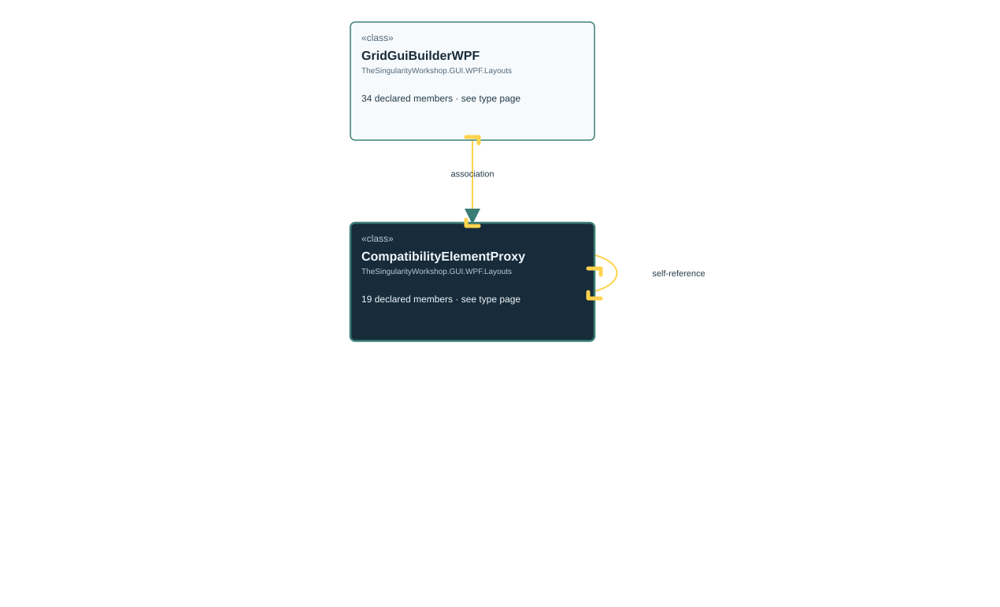

<!-- The Singularity Workshop moniker -->

# TheSingularityWorkshop.GUI.WPF.Layouts.GridGuiBuilderWPF.CompatibilityElementProxy

> Generated from compiler-backed source analysis. Do not edit by hand.

- Repository: `TrentBest/TheSingularityWorkshop.GUI`
- Revision: [`d01597026d83f798e62a2a144bfd9400a3cd44a8`](https://github.com/TrentBest/TheSingularityWorkshop.GUI/tree/d01597026d83f798e62a2a144bfd9400a3cd44a8)
- Project: `src/WPF/TheSingularityWorkshop.GUI.WPF.csproj`
- Type ID: `type:TheSingularityWorkshop.GUI.WPF, Version=0.1.0.0, Culture=neutral, PublicKeyToken=null:global::TheSingularityWorkshop.GUI.WPF.Layouts.GridGuiBuilderWPF.CompatibilityElementProxy`
- Metadata name: `CompatibilityElementProxy`
- Kind: `class`
- Generic arity: 0

## UML diagram

## Source declarations

- [`src/WPF/GridGuiBuilderWPF.cs:83-142`](https://github.com/TrentBest/TheSingularityWorkshop.GUI/blob/d01597026d83f798e62a2a144bfd9400a3cd44a8/src/WPF/GridGuiBuilderWPF.cs#L83-142)

## Members

| Kind | Signature | Source |
|---|---|---|
| `Property` | `TheSingularityWorkshop.GUI.WPF.Layouts.GridGuiBuilderWPF.CompatibilityElementProxy.Background` | [`src/WPF/GridGuiBuilderWPF.cs:92-96`](https://github.com/TrentBest/TheSingularityWorkshop.GUI/blob/d01597026d83f798e62a2a144bfd9400a3cd44a8/src/WPF/GridGuiBuilderWPF.cs#L92-96) |
| `Method` | `TheSingularityWorkshop.GUI.WPF.Layouts.GridGuiBuilderWPF.CompatibilityElementProxy.Background.get` | [`src/WPF/GridGuiBuilderWPF.cs:94-94`](https://github.com/TrentBest/TheSingularityWorkshop.GUI/blob/d01597026d83f798e62a2a144bfd9400a3cd44a8/src/WPF/GridGuiBuilderWPF.cs#L94-94) |
| `Method` | `TheSingularityWorkshop.GUI.WPF.Layouts.GridGuiBuilderWPF.CompatibilityElementProxy.Background.set` | [`src/WPF/GridGuiBuilderWPF.cs:95-95`](https://github.com/TrentBest/TheSingularityWorkshop.GUI/blob/d01597026d83f798e62a2a144bfd9400a3cd44a8/src/WPF/GridGuiBuilderWPF.cs#L95-95) |
| `Method` | `TheSingularityWorkshop.GUI.WPF.Layouts.GridGuiBuilderWPF.CompatibilityElementProxy.BeginAnimation(System.Windows.DependencyProperty, System.Windows.Media.Animation.AnimationTimeline)` | [`src/WPF/GridGuiBuilderWPF.cs:130-133`](https://github.com/TrentBest/TheSingularityWorkshop.GUI/blob/d01597026d83f798e62a2a144bfd9400a3cd44a8/src/WPF/GridGuiBuilderWPF.cs#L130-133) |
| `Property` | `TheSingularityWorkshop.GUI.WPF.Layouts.GridGuiBuilderWPF.CompatibilityElementProxy.BorderBrush` | [`src/WPF/GridGuiBuilderWPF.cs:99-103`](https://github.com/TrentBest/TheSingularityWorkshop.GUI/blob/d01597026d83f798e62a2a144bfd9400a3cd44a8/src/WPF/GridGuiBuilderWPF.cs#L99-103) |
| `Method` | `TheSingularityWorkshop.GUI.WPF.Layouts.GridGuiBuilderWPF.CompatibilityElementProxy.BorderBrush.get` | [`src/WPF/GridGuiBuilderWPF.cs:101-101`](https://github.com/TrentBest/TheSingularityWorkshop.GUI/blob/d01597026d83f798e62a2a144bfd9400a3cd44a8/src/WPF/GridGuiBuilderWPF.cs#L101-101) |
| `Method` | `TheSingularityWorkshop.GUI.WPF.Layouts.GridGuiBuilderWPF.CompatibilityElementProxy.BorderBrush.set` | [`src/WPF/GridGuiBuilderWPF.cs:102-102`](https://github.com/TrentBest/TheSingularityWorkshop.GUI/blob/d01597026d83f798e62a2a144bfd9400a3cd44a8/src/WPF/GridGuiBuilderWPF.cs#L102-102) |
| `Property` | `TheSingularityWorkshop.GUI.WPF.Layouts.GridGuiBuilderWPF.CompatibilityElementProxy.BorderThickness` | [`src/WPF/GridGuiBuilderWPF.cs:106-110`](https://github.com/TrentBest/TheSingularityWorkshop.GUI/blob/d01597026d83f798e62a2a144bfd9400a3cd44a8/src/WPF/GridGuiBuilderWPF.cs#L106-110) |
| `Method` | `TheSingularityWorkshop.GUI.WPF.Layouts.GridGuiBuilderWPF.CompatibilityElementProxy.BorderThickness.get` | [`src/WPF/GridGuiBuilderWPF.cs:108-108`](https://github.com/TrentBest/TheSingularityWorkshop.GUI/blob/d01597026d83f798e62a2a144bfd9400a3cd44a8/src/WPF/GridGuiBuilderWPF.cs#L108-108) |
| `Method` | `TheSingularityWorkshop.GUI.WPF.Layouts.GridGuiBuilderWPF.CompatibilityElementProxy.BorderThickness.set` | [`src/WPF/GridGuiBuilderWPF.cs:109-109`](https://github.com/TrentBest/TheSingularityWorkshop.GUI/blob/d01597026d83f798e62a2a144bfd9400a3cd44a8/src/WPF/GridGuiBuilderWPF.cs#L109-109) |
| `Property` | `TheSingularityWorkshop.GUI.WPF.Layouts.GridGuiBuilderWPF.CompatibilityElementProxy.Child` | [`src/WPF/GridGuiBuilderWPF.cs:125-125`](https://github.com/TrentBest/TheSingularityWorkshop.GUI/blob/d01597026d83f798e62a2a144bfd9400a3cd44a8/src/WPF/GridGuiBuilderWPF.cs#L125-125) |
| `Method` | `TheSingularityWorkshop.GUI.WPF.Layouts.GridGuiBuilderWPF.CompatibilityElementProxy.Child.get` | [`src/WPF/GridGuiBuilderWPF.cs:125-125`](https://github.com/TrentBest/TheSingularityWorkshop.GUI/blob/d01597026d83f798e62a2a144bfd9400a3cd44a8/src/WPF/GridGuiBuilderWPF.cs#L125-125) |
| `Method` | `TheSingularityWorkshop.GUI.WPF.Layouts.GridGuiBuilderWPF.CompatibilityElementProxy.CompatibilityElementProxy(System.Windows.Controls.Grid)` | [`src/WPF/GridGuiBuilderWPF.cs:89-89`](https://github.com/TrentBest/TheSingularityWorkshop.GUI/blob/d01597026d83f798e62a2a144bfd9400a3cd44a8/src/WPF/GridGuiBuilderWPF.cs#L89-89) |
| `Property` | `TheSingularityWorkshop.GUI.WPF.Layouts.GridGuiBuilderWPF.CompatibilityElementProxy.CornerRadius` | [`src/WPF/GridGuiBuilderWPF.cs:113-117`](https://github.com/TrentBest/TheSingularityWorkshop.GUI/blob/d01597026d83f798e62a2a144bfd9400a3cd44a8/src/WPF/GridGuiBuilderWPF.cs#L113-117) |
| `Method` | `TheSingularityWorkshop.GUI.WPF.Layouts.GridGuiBuilderWPF.CompatibilityElementProxy.CornerRadius.get` | [`src/WPF/GridGuiBuilderWPF.cs:115-115`](https://github.com/TrentBest/TheSingularityWorkshop.GUI/blob/d01597026d83f798e62a2a144bfd9400a3cd44a8/src/WPF/GridGuiBuilderWPF.cs#L115-115) |
| `Method` | `TheSingularityWorkshop.GUI.WPF.Layouts.GridGuiBuilderWPF.CompatibilityElementProxy.CornerRadius.set` | [`src/WPF/GridGuiBuilderWPF.cs:116-116`](https://github.com/TrentBest/TheSingularityWorkshop.GUI/blob/d01597026d83f798e62a2a144bfd9400a3cd44a8/src/WPF/GridGuiBuilderWPF.cs#L116-116) |
| `Field` | `TheSingularityWorkshop.GUI.WPF.Layouts.GridGuiBuilderWPF.CompatibilityElementProxy._grid` | [`src/WPF/GridGuiBuilderWPF.cs:86-86`](https://github.com/TrentBest/TheSingularityWorkshop.GUI/blob/d01597026d83f798e62a2a144bfd9400a3cd44a8/src/WPF/GridGuiBuilderWPF.cs#L86-86) |
| `Method` | `TheSingularityWorkshop.GUI.WPF.Layouts.GridGuiBuilderWPF.CompatibilityElementProxy.implicit operator System.Windows.FrameworkElement(TheSingularityWorkshop.GUI.WPF.Layouts.GridGuiBuilderWPF.CompatibilityElementProxy)` | [`src/WPF/GridGuiBuilderWPF.cs:138-138`](https://github.com/TrentBest/TheSingularityWorkshop.GUI/blob/d01597026d83f798e62a2a144bfd9400a3cd44a8/src/WPF/GridGuiBuilderWPF.cs#L138-138) |
| `Method` | `TheSingularityWorkshop.GUI.WPF.Layouts.GridGuiBuilderWPF.CompatibilityElementProxy.implicit operator System.Windows.UIElement(TheSingularityWorkshop.GUI.WPF.Layouts.GridGuiBuilderWPF.CompatibilityElementProxy)` | [`src/WPF/GridGuiBuilderWPF.cs:141-141`](https://github.com/TrentBest/TheSingularityWorkshop.GUI/blob/d01597026d83f798e62a2a144bfd9400a3cd44a8/src/WPF/GridGuiBuilderWPF.cs#L141-141) |

## Relationships

| Direction | Kind | Related type | Resolution | Evidence |
|---|---|---|---|---|
| incoming | `Association` | `TheSingularityWorkshop.GUI.WPF.Layouts.GridGuiBuilderWPF` | `Resolved` | [`src/WPF/GridGuiBuilderWPF.cs:48-48`](https://github.com/TrentBest/TheSingularityWorkshop.GUI/blob/d01597026d83f798e62a2a144bfd9400a3cd44a8/src/WPF/GridGuiBuilderWPF.cs#L48-48) |
| outgoing | `Dependency` | `TheSingularityWorkshop.GUI.WPF.Layouts.GridGuiBuilderWPF.CompatibilityElementProxy` | `Resolved` | [`src/WPF/GridGuiBuilderWPF.cs:138-138`](https://github.com/TrentBest/TheSingularityWorkshop.GUI/blob/d01597026d83f798e62a2a144bfd9400a3cd44a8/src/WPF/GridGuiBuilderWPF.cs#L138-138) |
| outgoing | `Dependency` | `TheSingularityWorkshop.GUI.WPF.Layouts.GridGuiBuilderWPF.CompatibilityElementProxy` | `Resolved` | [`src/WPF/GridGuiBuilderWPF.cs:141-141`](https://github.com/TrentBest/TheSingularityWorkshop.GUI/blob/d01597026d83f798e62a2a144bfd9400a3cd44a8/src/WPF/GridGuiBuilderWPF.cs#L141-141) |

[Back to the generated type index](index.md)

---

<!-- THE SINGULARITY WORKSHOP FOOTER -->

