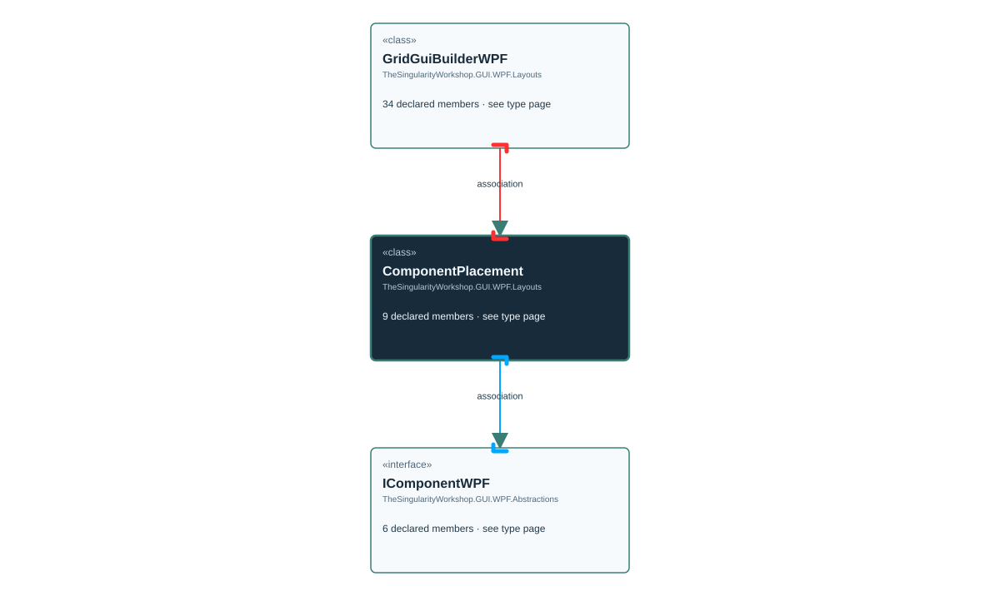

# TheSingularityWorkshop.GUI.WPF.Layouts.GridGuiBuilderWPF.ComponentPlacement

> Generated from compiler-backed source analysis. Do not edit by hand.

- Repository: `TrentBest/TheSingularityWorkshop.GUI`
- Revision: [`3844b48b1a30f678cb8aa80c2a21aaaceed9348b`](https://github.com/TrentBest/TheSingularityWorkshop.GUI/tree/3844b48b1a30f678cb8aa80c2a21aaaceed9348b)
- Project: `src/WPF/TheSingularityWorkshop.GUI.WPF.csproj`
- Type ID: `type:TheSingularityWorkshop.GUI.WPF, Version=0.1.0.0, Culture=neutral, PublicKeyToken=null:global::TheSingularityWorkshop.GUI.WPF.Layouts.GridGuiBuilderWPF.ComponentPlacement`
- Metadata name: `ComponentPlacement`
- Kind: `class`
- Generic arity: 0

## UML diagram

## Source declarations

- [`src/WPF/GridGuiBuilderWPF.cs:329-329`](https://github.com/TrentBest/TheSingularityWorkshop.GUI/blob/3844b48b1a30f678cb8aa80c2a21aaaceed9348b/src/WPF/GridGuiBuilderWPF.cs#L329-329)

## Members

| Kind | Signature | Source |
|---|---|---|
| `Property` | `TheSingularityWorkshop.GUI.WPF.Layouts.GridGuiBuilderWPF.ComponentPlacement.Col` | [`src/WPF/GridGuiBuilderWPF.cs:329-329`](https://github.com/TrentBest/TheSingularityWorkshop.GUI/blob/3844b48b1a30f678cb8aa80c2a21aaaceed9348b/src/WPF/GridGuiBuilderWPF.cs#L329-329) |
| `Method` | `TheSingularityWorkshop.GUI.WPF.Layouts.GridGuiBuilderWPF.ComponentPlacement.Col.get` | [`src/WPF/GridGuiBuilderWPF.cs:329-329`](https://github.com/TrentBest/TheSingularityWorkshop.GUI/blob/3844b48b1a30f678cb8aa80c2a21aaaceed9348b/src/WPF/GridGuiBuilderWPF.cs#L329-329) |
| `Method` | `TheSingularityWorkshop.GUI.WPF.Layouts.GridGuiBuilderWPF.ComponentPlacement.Col.set` | [`src/WPF/GridGuiBuilderWPF.cs:329-329`](https://github.com/TrentBest/TheSingularityWorkshop.GUI/blob/3844b48b1a30f678cb8aa80c2a21aaaceed9348b/src/WPF/GridGuiBuilderWPF.cs#L329-329) |
| `Property` | `TheSingularityWorkshop.GUI.WPF.Layouts.GridGuiBuilderWPF.ComponentPlacement.Component` | [`src/WPF/GridGuiBuilderWPF.cs:329-329`](https://github.com/TrentBest/TheSingularityWorkshop.GUI/blob/3844b48b1a30f678cb8aa80c2a21aaaceed9348b/src/WPF/GridGuiBuilderWPF.cs#L329-329) |
| `Method` | `TheSingularityWorkshop.GUI.WPF.Layouts.GridGuiBuilderWPF.ComponentPlacement.Component.get` | [`src/WPF/GridGuiBuilderWPF.cs:329-329`](https://github.com/TrentBest/TheSingularityWorkshop.GUI/blob/3844b48b1a30f678cb8aa80c2a21aaaceed9348b/src/WPF/GridGuiBuilderWPF.cs#L329-329) |
| `Method` | `TheSingularityWorkshop.GUI.WPF.Layouts.GridGuiBuilderWPF.ComponentPlacement.Component.set` | [`src/WPF/GridGuiBuilderWPF.cs:329-329`](https://github.com/TrentBest/TheSingularityWorkshop.GUI/blob/3844b48b1a30f678cb8aa80c2a21aaaceed9348b/src/WPF/GridGuiBuilderWPF.cs#L329-329) |
| `Property` | `TheSingularityWorkshop.GUI.WPF.Layouts.GridGuiBuilderWPF.ComponentPlacement.Row` | [`src/WPF/GridGuiBuilderWPF.cs:329-329`](https://github.com/TrentBest/TheSingularityWorkshop.GUI/blob/3844b48b1a30f678cb8aa80c2a21aaaceed9348b/src/WPF/GridGuiBuilderWPF.cs#L329-329) |
| `Method` | `TheSingularityWorkshop.GUI.WPF.Layouts.GridGuiBuilderWPF.ComponentPlacement.Row.get` | [`src/WPF/GridGuiBuilderWPF.cs:329-329`](https://github.com/TrentBest/TheSingularityWorkshop.GUI/blob/3844b48b1a30f678cb8aa80c2a21aaaceed9348b/src/WPF/GridGuiBuilderWPF.cs#L329-329) |
| `Method` | `TheSingularityWorkshop.GUI.WPF.Layouts.GridGuiBuilderWPF.ComponentPlacement.Row.set` | [`src/WPF/GridGuiBuilderWPF.cs:329-329`](https://github.com/TrentBest/TheSingularityWorkshop.GUI/blob/3844b48b1a30f678cb8aa80c2a21aaaceed9348b/src/WPF/GridGuiBuilderWPF.cs#L329-329) |

## Relationships

| Direction | Kind | Related type | Resolution | Evidence |
|---|---|---|---|---|
| incoming | `Association` | `TheSingularityWorkshop.GUI.WPF.Layouts.GridGuiBuilderWPF` | `Resolved` | [`src/WPF/GridGuiBuilderWPF.cs:21-21`](https://github.com/TrentBest/TheSingularityWorkshop.GUI/blob/3844b48b1a30f678cb8aa80c2a21aaaceed9348b/src/WPF/GridGuiBuilderWPF.cs#L21-21) |
| outgoing | `Association` | `TheSingularityWorkshop.GUI.WPF.Abstractions.IComponentWPF` | `Resolved` | [`src/WPF/GridGuiBuilderWPF.cs:329-329`](https://github.com/TrentBest/TheSingularityWorkshop.GUI/blob/3844b48b1a30f678cb8aa80c2a21aaaceed9348b/src/WPF/GridGuiBuilderWPF.cs#L329-329) |

[Back to the generated type index](index.md)

