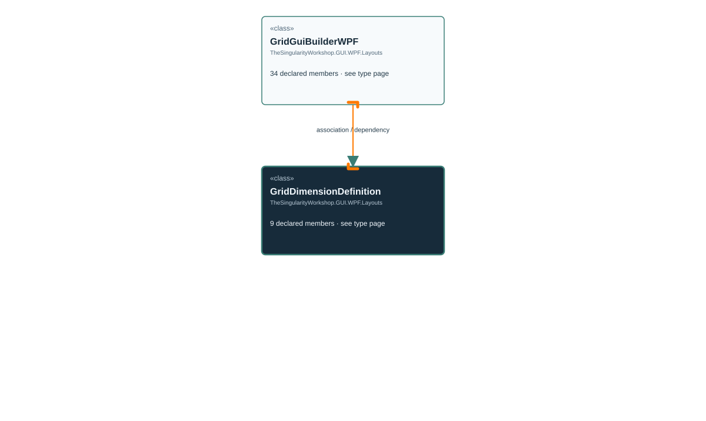

# TheSingularityWorkshop.GUI.WPF.Layouts.GridGuiBuilderWPF.GridDimensionDefinition

> Generated from compiler-backed source analysis. Do not edit by hand.

- Repository: `TrentBest/TheSingularityWorkshop.GUI`
- Revision: [`8d11c5f449b73b519cfb1819c9c3942307f717c6`](https://github.com/TrentBest/TheSingularityWorkshop.GUI/tree/8d11c5f449b73b519cfb1819c9c3942307f717c6)
- Project: `src/WPF/TheSingularityWorkshop.GUI.WPF.csproj`
- Type ID: `type:TheSingularityWorkshop.GUI.WPF, Version=0.1.0.0, Culture=neutral, PublicKeyToken=null:global::TheSingularityWorkshop.GUI.WPF.Layouts.GridGuiBuilderWPF.GridDimensionDefinition`
- Metadata name: `GridDimensionDefinition`
- Kind: `class`
- Generic arity: 0

## UML diagram

## Source declarations

- [`src/WPF/GridGuiBuilderWPF.cs:328-328`](https://github.com/TrentBest/TheSingularityWorkshop.GUI/blob/8d11c5f449b73b519cfb1819c9c3942307f717c6/src/WPF/GridGuiBuilderWPF.cs#L328-328)

## Members

| Kind | Signature | Source |
|---|---|---|
| `Property` | `TheSingularityWorkshop.GUI.WPF.Layouts.GridGuiBuilderWPF.GridDimensionDefinition.IsResizable` | [`src/WPF/GridGuiBuilderWPF.cs:328-328`](https://github.com/TrentBest/TheSingularityWorkshop.GUI/blob/8d11c5f449b73b519cfb1819c9c3942307f717c6/src/WPF/GridGuiBuilderWPF.cs#L328-328) |
| `Method` | `TheSingularityWorkshop.GUI.WPF.Layouts.GridGuiBuilderWPF.GridDimensionDefinition.IsResizable.get` | [`src/WPF/GridGuiBuilderWPF.cs:328-328`](https://github.com/TrentBest/TheSingularityWorkshop.GUI/blob/8d11c5f449b73b519cfb1819c9c3942307f717c6/src/WPF/GridGuiBuilderWPF.cs#L328-328) |
| `Method` | `TheSingularityWorkshop.GUI.WPF.Layouts.GridGuiBuilderWPF.GridDimensionDefinition.IsResizable.set` | [`src/WPF/GridGuiBuilderWPF.cs:328-328`](https://github.com/TrentBest/TheSingularityWorkshop.GUI/blob/8d11c5f449b73b519cfb1819c9c3942307f717c6/src/WPF/GridGuiBuilderWPF.cs#L328-328) |
| `Property` | `TheSingularityWorkshop.GUI.WPF.Layouts.GridGuiBuilderWPF.GridDimensionDefinition.UnitType` | [`src/WPF/GridGuiBuilderWPF.cs:328-328`](https://github.com/TrentBest/TheSingularityWorkshop.GUI/blob/8d11c5f449b73b519cfb1819c9c3942307f717c6/src/WPF/GridGuiBuilderWPF.cs#L328-328) |
| `Method` | `TheSingularityWorkshop.GUI.WPF.Layouts.GridGuiBuilderWPF.GridDimensionDefinition.UnitType.get` | [`src/WPF/GridGuiBuilderWPF.cs:328-328`](https://github.com/TrentBest/TheSingularityWorkshop.GUI/blob/8d11c5f449b73b519cfb1819c9c3942307f717c6/src/WPF/GridGuiBuilderWPF.cs#L328-328) |
| `Method` | `TheSingularityWorkshop.GUI.WPF.Layouts.GridGuiBuilderWPF.GridDimensionDefinition.UnitType.set` | [`src/WPF/GridGuiBuilderWPF.cs:328-328`](https://github.com/TrentBest/TheSingularityWorkshop.GUI/blob/8d11c5f449b73b519cfb1819c9c3942307f717c6/src/WPF/GridGuiBuilderWPF.cs#L328-328) |
| `Property` | `TheSingularityWorkshop.GUI.WPF.Layouts.GridGuiBuilderWPF.GridDimensionDefinition.Value` | [`src/WPF/GridGuiBuilderWPF.cs:328-328`](https://github.com/TrentBest/TheSingularityWorkshop.GUI/blob/8d11c5f449b73b519cfb1819c9c3942307f717c6/src/WPF/GridGuiBuilderWPF.cs#L328-328) |
| `Method` | `TheSingularityWorkshop.GUI.WPF.Layouts.GridGuiBuilderWPF.GridDimensionDefinition.Value.get` | [`src/WPF/GridGuiBuilderWPF.cs:328-328`](https://github.com/TrentBest/TheSingularityWorkshop.GUI/blob/8d11c5f449b73b519cfb1819c9c3942307f717c6/src/WPF/GridGuiBuilderWPF.cs#L328-328) |
| `Method` | `TheSingularityWorkshop.GUI.WPF.Layouts.GridGuiBuilderWPF.GridDimensionDefinition.Value.set` | [`src/WPF/GridGuiBuilderWPF.cs:328-328`](https://github.com/TrentBest/TheSingularityWorkshop.GUI/blob/8d11c5f449b73b519cfb1819c9c3942307f717c6/src/WPF/GridGuiBuilderWPF.cs#L328-328) |

## Relationships

| Direction | Kind | Related type | Resolution | Evidence |
|---|---|---|---|---|
| incoming | `Association` | `TheSingularityWorkshop.GUI.WPF.Layouts.GridGuiBuilderWPF` | `Resolved` | [`src/WPF/GridGuiBuilderWPF.cs:19-19`](https://github.com/TrentBest/TheSingularityWorkshop.GUI/blob/8d11c5f449b73b519cfb1819c9c3942307f717c6/src/WPF/GridGuiBuilderWPF.cs#L19-19) |
| incoming | `Association` | `TheSingularityWorkshop.GUI.WPF.Layouts.GridGuiBuilderWPF` | `Resolved` | [`src/WPF/GridGuiBuilderWPF.cs:20-20`](https://github.com/TrentBest/TheSingularityWorkshop.GUI/blob/8d11c5f449b73b519cfb1819c9c3942307f717c6/src/WPF/GridGuiBuilderWPF.cs#L20-20) |
| incoming | `Dependency` | `TheSingularityWorkshop.GUI.WPF.Layouts.GridGuiBuilderWPF` | `Resolved` | [`src/WPF/GridGuiBuilderWPF.cs:312-321`](https://github.com/TrentBest/TheSingularityWorkshop.GUI/blob/8d11c5f449b73b519cfb1819c9c3942307f717c6/src/WPF/GridGuiBuilderWPF.cs#L312-321) |

[Back to the generated type index](index.md)

