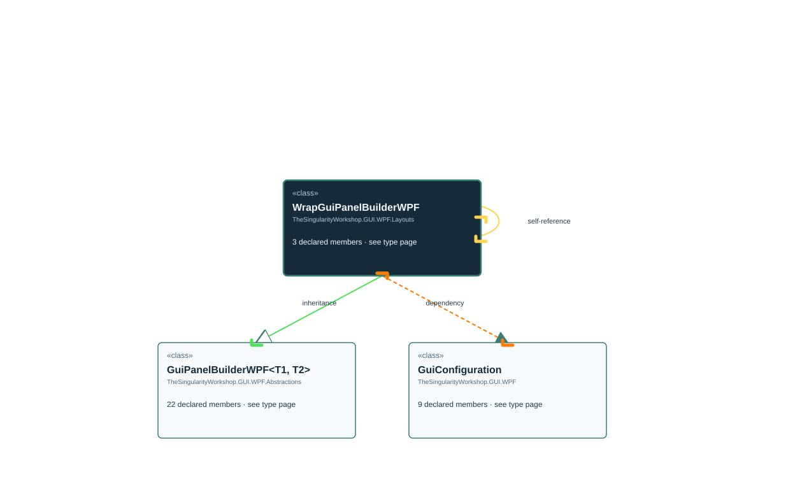

<!-- The Singularity Workshop moniker -->

# TheSingularityWorkshop.GUI.WPF.Layouts.WrapGuiPanelBuilderWPF

> Generated from compiler-backed source analysis. Do not edit by hand.

- Repository: `TrentBest/TheSingularityWorkshop.GUI`
- Revision: [`59362b4a57a60809f338977e3e978b9eb3ee5099`](https://github.com/TrentBest/TheSingularityWorkshop.GUI/tree/59362b4a57a60809f338977e3e978b9eb3ee5099)
- Project: `src/WPF/TheSingularityWorkshop.GUI.WPF.csproj`
- Type ID: `type:TheSingularityWorkshop.GUI.WPF, Version=0.1.0.0, Culture=neutral, PublicKeyToken=null:global::TheSingularityWorkshop.GUI.WPF.Layouts.WrapGuiPanelBuilderWPF`
- Metadata name: `WrapGuiPanelBuilderWPF`
- Kind: `class`
- Generic arity: 0

## UML diagram

## Source declarations

- [`src/WPF/WrapGuiPanelBuilderWPF.cs:6-24`](https://github.com/TrentBest/TheSingularityWorkshop.GUI/blob/59362b4a57a60809f338977e3e978b9eb3ee5099/src/WPF/WrapGuiPanelBuilderWPF.cs#L6-24)

## Members

| Kind | Signature | Source |
|---|---|---|
| `Method` | `TheSingularityWorkshop.GUI.WPF.Layouts.WrapGuiPanelBuilderWPF.WithItemDimensions(double, double)` | [`src/WPF/WrapGuiPanelBuilderWPF.cs:16-23`](https://github.com/TrentBest/TheSingularityWorkshop.GUI/blob/59362b4a57a60809f338977e3e978b9eb3ee5099/src/WPF/WrapGuiPanelBuilderWPF.cs#L16-23) |
| `Method` | `TheSingularityWorkshop.GUI.WPF.Layouts.WrapGuiPanelBuilderWPF.WithOrientation(System.Windows.Controls.Orientation)` | [`src/WPF/WrapGuiPanelBuilderWPF.cs:10-14`](https://github.com/TrentBest/TheSingularityWorkshop.GUI/blob/59362b4a57a60809f338977e3e978b9eb3ee5099/src/WPF/WrapGuiPanelBuilderWPF.cs#L10-14) |
| `Method` | `TheSingularityWorkshop.GUI.WPF.Layouts.WrapGuiPanelBuilderWPF.WrapGuiPanelBuilderWPF(TheSingularityWorkshop.GUI.WPF.GuiConfiguration)` | [`src/WPF/WrapGuiPanelBuilderWPF.cs:8-8`](https://github.com/TrentBest/TheSingularityWorkshop.GUI/blob/59362b4a57a60809f338977e3e978b9eb3ee5099/src/WPF/WrapGuiPanelBuilderWPF.cs#L8-8) |

## Relationships

| Direction | Kind | Related type | Resolution | Evidence |
|---|---|---|---|---|
| outgoing | `Inheritance` | `TheSingularityWorkshop.GUI.WPF.Abstractions.GuiPanelBuilderWPF` | `Resolved` | [`src/WPF/WrapGuiPanelBuilderWPF.cs:6-24`](https://github.com/TrentBest/TheSingularityWorkshop.GUI/blob/59362b4a57a60809f338977e3e978b9eb3ee5099/src/WPF/WrapGuiPanelBuilderWPF.cs#L6-24) |
| outgoing | `Dependency` | `TheSingularityWorkshop.GUI.WPF.GuiConfiguration` | `Resolved` | [`src/WPF/WrapGuiPanelBuilderWPF.cs:8-8`](https://github.com/TrentBest/TheSingularityWorkshop.GUI/blob/59362b4a57a60809f338977e3e978b9eb3ee5099/src/WPF/WrapGuiPanelBuilderWPF.cs#L8-8) |
| outgoing | `Dependency` | `TheSingularityWorkshop.GUI.WPF.Layouts.WrapGuiPanelBuilderWPF` | `Resolved` | [`src/WPF/WrapGuiPanelBuilderWPF.cs:16-23`](https://github.com/TrentBest/TheSingularityWorkshop.GUI/blob/59362b4a57a60809f338977e3e978b9eb3ee5099/src/WPF/WrapGuiPanelBuilderWPF.cs#L16-23) |
| outgoing | `Dependency` | `TheSingularityWorkshop.GUI.WPF.Layouts.WrapGuiPanelBuilderWPF` | `Resolved` | [`src/WPF/WrapGuiPanelBuilderWPF.cs:10-14`](https://github.com/TrentBest/TheSingularityWorkshop.GUI/blob/59362b4a57a60809f338977e3e978b9eb3ee5099/src/WPF/WrapGuiPanelBuilderWPF.cs#L10-14) |

[Back to the generated type index](index.md)

---

<!-- THE SINGULARITY WORKSHOP FOOTER -->

