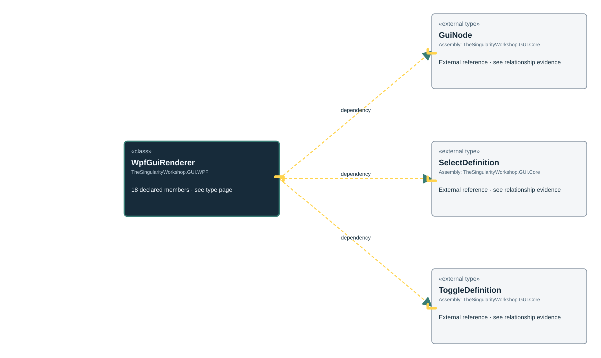

<!-- The Singularity Workshop moniker -->

# TheSingularityWorkshop.GUI.WPF.WpfGuiRenderer

> Generated from compiler-backed source analysis. Do not edit by hand.

- Repository: `TrentBest/TheSingularityWorkshop.GUI`
- Revision: [`0ed09cdac84f1bfac1b809bc27f6ce68bb23d385`](https://github.com/TrentBest/TheSingularityWorkshop.GUI/tree/0ed09cdac84f1bfac1b809bc27f6ce68bb23d385)
- Project: `src/WPF/TheSingularityWorkshop.GUI.WPF.csproj`
- Type ID: `type:TheSingularityWorkshop.GUI.WPF, Version=0.1.0.0, Culture=neutral, PublicKeyToken=null:global::TheSingularityWorkshop.GUI.WPF.WpfGuiRenderer`
- Metadata name: `WpfGuiRenderer`
- Kind: `class`
- Generic arity: 0

## UML diagram

## Source declarations

- [`src/WPF/WpfGuiRenderer.cs:18-406`](https://github.com/TrentBest/TheSingularityWorkshop.GUI/blob/0ed09cdac84f1bfac1b809bc27f6ce68bb23d385/src/WPF/WpfGuiRenderer.cs#L18-406)

## Members

| Kind | Signature | Source |
|---|---|---|
| `Method` | `TheSingularityWorkshop.GUI.WPF.WpfGuiRenderer.ApplyProperties(System.Windows.FrameworkElement, TheSingularityWorkshop.Workshop.Gui.GuiNode)` | [`src/WPF/WpfGuiRenderer.cs:241-334`](https://github.com/TrentBest/TheSingularityWorkshop.GUI/blob/0ed09cdac84f1bfac1b809bc27f6ce68bb23d385/src/WPF/WpfGuiRenderer.cs#L241-334) |
| `Method` | `TheSingularityWorkshop.GUI.WPF.WpfGuiRenderer.CreateImage(string?)` | [`src/WPF/WpfGuiRenderer.cs:214-239`](https://github.com/TrentBest/TheSingularityWorkshop.GUI/blob/0ed09cdac84f1bfac1b809bc27f6ce68bb23d385/src/WPF/WpfGuiRenderer.cs#L214-239) |
| `Method` | `TheSingularityWorkshop.GUI.WPF.WpfGuiRenderer.CreateSelect(TheSingularityWorkshop.Workshop.Gui.SelectDefinition, System.Action<string, string?>?)` | [`src/WPF/WpfGuiRenderer.cs:136-155`](https://github.com/TrentBest/TheSingularityWorkshop.GUI/blob/0ed09cdac84f1bfac1b809bc27f6ce68bb23d385/src/WPF/WpfGuiRenderer.cs#L136-155) |
| `Method` | `TheSingularityWorkshop.GUI.WPF.WpfGuiRenderer.CreateToggle(TheSingularityWorkshop.Workshop.Gui.GuiNode, TheSingularityWorkshop.Workshop.Gui.ToggleDefinition, System.Action<string, string?>?)` | [`src/WPF/WpfGuiRenderer.cs:157-167`](https://github.com/TrentBest/TheSingularityWorkshop.GUI/blob/0ed09cdac84f1bfac1b809bc27f6ce68bb23d385/src/WPF/WpfGuiRenderer.cs#L157-167) |
| `Method` | `TheSingularityWorkshop.GUI.WPF.WpfGuiRenderer.CreateWarning(string?)` | [`src/WPF/WpfGuiRenderer.cs:199-212`](https://github.com/TrentBest/TheSingularityWorkshop.GUI/blob/0ed09cdac84f1bfac1b809bc27f6ce68bb23d385/src/WPF/WpfGuiRenderer.cs#L199-212) |
| `Method` | `TheSingularityWorkshop.GUI.WPF.WpfGuiRenderer.GetChildrenHost(System.Windows.FrameworkElement)` | [`src/WPF/WpfGuiRenderer.cs:192-197`](https://github.com/TrentBest/TheSingularityWorkshop.GUI/blob/0ed09cdac84f1bfac1b809bc27f6ce68bb23d385/src/WPF/WpfGuiRenderer.cs#L192-197) |
| `Method` | `TheSingularityWorkshop.GUI.WPF.WpfGuiRenderer.IsLegalName(string)` | [`src/WPF/WpfGuiRenderer.cs:402-405`](https://github.com/TrentBest/TheSingularityWorkshop.GUI/blob/0ed09cdac84f1bfac1b809bc27f6ce68bb23d385/src/WPF/WpfGuiRenderer.cs#L402-405) |
| `Field` | `TheSingularityWorkshop.GUI.WPF.WpfGuiRenderer.MaximumTreeDepth` | [`src/WPF/WpfGuiRenderer.cs:20-20`](https://github.com/TrentBest/TheSingularityWorkshop.GUI/blob/0ed09cdac84f1bfac1b809bc27f6ce68bb23d385/src/WPF/WpfGuiRenderer.cs#L20-20) |
| `Method` | `TheSingularityWorkshop.GUI.WPF.WpfGuiRenderer.Render(TheSingularityWorkshop.Workshop.Gui.GuiNode)` | [`src/WPF/WpfGuiRenderer.cs:23-28`](https://github.com/TrentBest/TheSingularityWorkshop.GUI/blob/0ed09cdac84f1bfac1b809bc27f6ce68bb23d385/src/WPF/WpfGuiRenderer.cs#L23-28) |
| `Method` | `TheSingularityWorkshop.GUI.WPF.WpfGuiRenderer.Render(TheSingularityWorkshop.Workshop.Gui.GuiNode, System.Action<string, string?>)` | [`src/WPF/WpfGuiRenderer.cs:46-52`](https://github.com/TrentBest/TheSingularityWorkshop.GUI/blob/0ed09cdac84f1bfac1b809bc27f6ce68bb23d385/src/WPF/WpfGuiRenderer.cs#L46-52) |
| `Method` | `TheSingularityWorkshop.GUI.WPF.WpfGuiRenderer.Render(TheSingularityWorkshop.Workshop.Gui.GuiNode, System.Action<string>)` | [`src/WPF/WpfGuiRenderer.cs:34-40`](https://github.com/TrentBest/TheSingularityWorkshop.GUI/blob/0ed09cdac84f1bfac1b809bc27f6ce68bb23d385/src/WPF/WpfGuiRenderer.cs#L34-40) |
| `Method` | `TheSingularityWorkshop.GUI.WPF.WpfGuiRenderer.RenderValidated(TheSingularityWorkshop.Workshop.Gui.GuiNode, System.Action<string>?, System.Action<string, string?>?)` | [`src/WPF/WpfGuiRenderer.cs:54-134`](https://github.com/TrentBest/TheSingularityWorkshop.GUI/blob/0ed09cdac84f1bfac1b809bc27f6ce68bb23d385/src/WPF/WpfGuiRenderer.cs#L54-134) |
| `Method` | `TheSingularityWorkshop.GUI.WPF.WpfGuiRenderer.TryBrush(string, out System.Windows.Media.Brush)` | [`src/WPF/WpfGuiRenderer.cs:388-400`](https://github.com/TrentBest/TheSingularityWorkshop.GUI/blob/0ed09cdac84f1bfac1b809bc27f6ce68bb23d385/src/WPF/WpfGuiRenderer.cs#L388-400) |
| `Method` | `TheSingularityWorkshop.GUI.WPF.WpfGuiRenderer.TryDouble(string, out double)` | [`src/WPF/WpfGuiRenderer.cs:336-338`](https://github.com/TrentBest/TheSingularityWorkshop.GUI/blob/0ed09cdac84f1bfac1b809bc27f6ce68bb23d385/src/WPF/WpfGuiRenderer.cs#L336-338) |
| `Method` | `TheSingularityWorkshop.GUI.WPF.WpfGuiRenderer.TryFontFamily(string, out System.Windows.Media.FontFamily)` | [`src/WPF/WpfGuiRenderer.cs:363-375`](https://github.com/TrentBest/TheSingularityWorkshop.GUI/blob/0ed09cdac84f1bfac1b809bc27f6ce68bb23d385/src/WPF/WpfGuiRenderer.cs#L363-375) |
| `Method` | `TheSingularityWorkshop.GUI.WPF.WpfGuiRenderer.TryResourceKey(string, out string)` | [`src/WPF/WpfGuiRenderer.cs:379-386`](https://github.com/TrentBest/TheSingularityWorkshop.GUI/blob/0ed09cdac84f1bfac1b809bc27f6ce68bb23d385/src/WPF/WpfGuiRenderer.cs#L379-386) |
| `Method` | `TheSingularityWorkshop.GUI.WPF.WpfGuiRenderer.TryThickness(string, out System.Windows.Thickness, bool)` | [`src/WPF/WpfGuiRenderer.cs:340-361`](https://github.com/TrentBest/TheSingularityWorkshop.GUI/blob/0ed09cdac84f1bfac1b809bc27f6ce68bb23d385/src/WPF/WpfGuiRenderer.cs#L340-361) |
| `Method` | `TheSingularityWorkshop.GUI.WPF.WpfGuiRenderer.ValidateTree(TheSingularityWorkshop.Workshop.Gui.GuiNode)` | [`src/WPF/WpfGuiRenderer.cs:169-190`](https://github.com/TrentBest/TheSingularityWorkshop.GUI/blob/0ed09cdac84f1bfac1b809bc27f6ce68bb23d385/src/WPF/WpfGuiRenderer.cs#L169-190) |

## Relationships

| Direction | Kind | Related type | Resolution | Evidence |
|---|---|---|---|---|
| outgoing | `Dependency` | `global::TheSingularityWorkshop.Workshop.Gui.GuiNode` | `External` | [`src/WPF/WpfGuiRenderer.cs:241-334`](https://github.com/TrentBest/TheSingularityWorkshop.GUI/blob/0ed09cdac84f1bfac1b809bc27f6ce68bb23d385/src/WPF/WpfGuiRenderer.cs#L241-334) |
| outgoing | `Dependency` | `global::TheSingularityWorkshop.Workshop.Gui.GuiNode` | `External` | [`src/WPF/WpfGuiRenderer.cs:157-167`](https://github.com/TrentBest/TheSingularityWorkshop.GUI/blob/0ed09cdac84f1bfac1b809bc27f6ce68bb23d385/src/WPF/WpfGuiRenderer.cs#L157-167) |
| outgoing | `Dependency` | `global::TheSingularityWorkshop.Workshop.Gui.GuiNode` | `External` | [`src/WPF/WpfGuiRenderer.cs:23-28`](https://github.com/TrentBest/TheSingularityWorkshop.GUI/blob/0ed09cdac84f1bfac1b809bc27f6ce68bb23d385/src/WPF/WpfGuiRenderer.cs#L23-28) |
| outgoing | `Dependency` | `global::TheSingularityWorkshop.Workshop.Gui.GuiNode` | `External` | [`src/WPF/WpfGuiRenderer.cs:46-52`](https://github.com/TrentBest/TheSingularityWorkshop.GUI/blob/0ed09cdac84f1bfac1b809bc27f6ce68bb23d385/src/WPF/WpfGuiRenderer.cs#L46-52) |
| outgoing | `Dependency` | `global::TheSingularityWorkshop.Workshop.Gui.GuiNode` | `External` | [`src/WPF/WpfGuiRenderer.cs:34-40`](https://github.com/TrentBest/TheSingularityWorkshop.GUI/blob/0ed09cdac84f1bfac1b809bc27f6ce68bb23d385/src/WPF/WpfGuiRenderer.cs#L34-40) |
| outgoing | `Dependency` | `global::TheSingularityWorkshop.Workshop.Gui.GuiNode` | `External` | [`src/WPF/WpfGuiRenderer.cs:54-134`](https://github.com/TrentBest/TheSingularityWorkshop.GUI/blob/0ed09cdac84f1bfac1b809bc27f6ce68bb23d385/src/WPF/WpfGuiRenderer.cs#L54-134) |
| outgoing | `Dependency` | `global::TheSingularityWorkshop.Workshop.Gui.GuiNode` | `External` | [`src/WPF/WpfGuiRenderer.cs:169-190`](https://github.com/TrentBest/TheSingularityWorkshop.GUI/blob/0ed09cdac84f1bfac1b809bc27f6ce68bb23d385/src/WPF/WpfGuiRenderer.cs#L169-190) |
| outgoing | `Dependency` | `global::TheSingularityWorkshop.Workshop.Gui.SelectDefinition` | `External` | [`src/WPF/WpfGuiRenderer.cs:136-155`](https://github.com/TrentBest/TheSingularityWorkshop.GUI/blob/0ed09cdac84f1bfac1b809bc27f6ce68bb23d385/src/WPF/WpfGuiRenderer.cs#L136-155) |
| outgoing | `Dependency` | `global::TheSingularityWorkshop.Workshop.Gui.ToggleDefinition` | `External` | [`src/WPF/WpfGuiRenderer.cs:157-167`](https://github.com/TrentBest/TheSingularityWorkshop.GUI/blob/0ed09cdac84f1bfac1b809bc27f6ce68bb23d385/src/WPF/WpfGuiRenderer.cs#L157-167) |

[Back to the generated type index](index.md)

---

<!-- THE SINGULARITY WORKSHOP FOOTER -->

