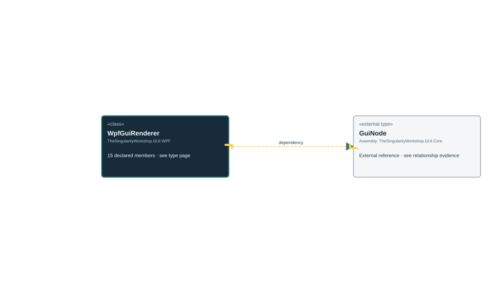

<!-- The Singularity Workshop moniker -->

# TheSingularityWorkshop.GUI.WPF.WpfGuiRenderer

> Generated from compiler-backed source analysis. Do not edit by hand.

- Repository: `TrentBest/TheSingularityWorkshop.GUI`
- Revision: [`f48dd15256521c88fad88371742c89d5fd1d326f`](https://github.com/TrentBest/TheSingularityWorkshop.GUI/tree/f48dd15256521c88fad88371742c89d5fd1d326f)
- Project: `src/WPF/TheSingularityWorkshop.GUI.WPF.csproj`
- Type ID: `type:TheSingularityWorkshop.GUI.WPF, Version=0.1.0.0, Culture=neutral, PublicKeyToken=null:global::TheSingularityWorkshop.GUI.WPF.WpfGuiRenderer`
- Metadata name: `WpfGuiRenderer`
- Kind: `class`
- Generic arity: 0

## UML diagram

## Source declarations

- [`src/WPF/WpfGuiRenderer.cs:18-321`](https://github.com/TrentBest/TheSingularityWorkshop.GUI/blob/f48dd15256521c88fad88371742c89d5fd1d326f/src/WPF/WpfGuiRenderer.cs#L18-321)

## Members

| Kind | Signature | Source |
|---|---|---|
| `Method` | `TheSingularityWorkshop.GUI.WPF.WpfGuiRenderer.ApplyProperties(System.Windows.FrameworkElement, TheSingularityWorkshop.Workshop.Gui.GuiNode)` | [`src/WPF/WpfGuiRenderer.cs:160-249`](https://github.com/TrentBest/TheSingularityWorkshop.GUI/blob/f48dd15256521c88fad88371742c89d5fd1d326f/src/WPF/WpfGuiRenderer.cs#L160-249) |
| `Method` | `TheSingularityWorkshop.GUI.WPF.WpfGuiRenderer.CreateImage(string?)` | [`src/WPF/WpfGuiRenderer.cs:133-158`](https://github.com/TrentBest/TheSingularityWorkshop.GUI/blob/f48dd15256521c88fad88371742c89d5fd1d326f/src/WPF/WpfGuiRenderer.cs#L133-158) |
| `Method` | `TheSingularityWorkshop.GUI.WPF.WpfGuiRenderer.CreateWarning(string?)` | [`src/WPF/WpfGuiRenderer.cs:118-131`](https://github.com/TrentBest/TheSingularityWorkshop.GUI/blob/f48dd15256521c88fad88371742c89d5fd1d326f/src/WPF/WpfGuiRenderer.cs#L118-131) |
| `Method` | `TheSingularityWorkshop.GUI.WPF.WpfGuiRenderer.GetChildrenHost(System.Windows.FrameworkElement)` | [`src/WPF/WpfGuiRenderer.cs:111-116`](https://github.com/TrentBest/TheSingularityWorkshop.GUI/blob/f48dd15256521c88fad88371742c89d5fd1d326f/src/WPF/WpfGuiRenderer.cs#L111-116) |
| `Method` | `TheSingularityWorkshop.GUI.WPF.WpfGuiRenderer.IsLegalName(string)` | [`src/WPF/WpfGuiRenderer.cs:317-320`](https://github.com/TrentBest/TheSingularityWorkshop.GUI/blob/f48dd15256521c88fad88371742c89d5fd1d326f/src/WPF/WpfGuiRenderer.cs#L317-320) |
| `Field` | `TheSingularityWorkshop.GUI.WPF.WpfGuiRenderer.MaximumTreeDepth` | [`src/WPF/WpfGuiRenderer.cs:20-20`](https://github.com/TrentBest/TheSingularityWorkshop.GUI/blob/f48dd15256521c88fad88371742c89d5fd1d326f/src/WPF/WpfGuiRenderer.cs#L20-20) |
| `Method` | `TheSingularityWorkshop.GUI.WPF.WpfGuiRenderer.Render(TheSingularityWorkshop.Workshop.Gui.GuiNode)` | [`src/WPF/WpfGuiRenderer.cs:23-28`](https://github.com/TrentBest/TheSingularityWorkshop.GUI/blob/f48dd15256521c88fad88371742c89d5fd1d326f/src/WPF/WpfGuiRenderer.cs#L23-28) |
| `Method` | `TheSingularityWorkshop.GUI.WPF.WpfGuiRenderer.Render(TheSingularityWorkshop.Workshop.Gui.GuiNode, System.Action<string>)` | [`src/WPF/WpfGuiRenderer.cs:34-40`](https://github.com/TrentBest/TheSingularityWorkshop.GUI/blob/f48dd15256521c88fad88371742c89d5fd1d326f/src/WPF/WpfGuiRenderer.cs#L34-40) |
| `Method` | `TheSingularityWorkshop.GUI.WPF.WpfGuiRenderer.RenderValidated(TheSingularityWorkshop.Workshop.Gui.GuiNode, System.Action<string>?)` | [`src/WPF/WpfGuiRenderer.cs:42-86`](https://github.com/TrentBest/TheSingularityWorkshop.GUI/blob/f48dd15256521c88fad88371742c89d5fd1d326f/src/WPF/WpfGuiRenderer.cs#L42-86) |
| `Method` | `TheSingularityWorkshop.GUI.WPF.WpfGuiRenderer.TryBrush(string, out System.Windows.Media.Brush)` | [`src/WPF/WpfGuiRenderer.cs:303-315`](https://github.com/TrentBest/TheSingularityWorkshop.GUI/blob/f48dd15256521c88fad88371742c89d5fd1d326f/src/WPF/WpfGuiRenderer.cs#L303-315) |
| `Method` | `TheSingularityWorkshop.GUI.WPF.WpfGuiRenderer.TryDouble(string, out double)` | [`src/WPF/WpfGuiRenderer.cs:251-253`](https://github.com/TrentBest/TheSingularityWorkshop.GUI/blob/f48dd15256521c88fad88371742c89d5fd1d326f/src/WPF/WpfGuiRenderer.cs#L251-253) |
| `Method` | `TheSingularityWorkshop.GUI.WPF.WpfGuiRenderer.TryFontFamily(string, out System.Windows.Media.FontFamily)` | [`src/WPF/WpfGuiRenderer.cs:278-290`](https://github.com/TrentBest/TheSingularityWorkshop.GUI/blob/f48dd15256521c88fad88371742c89d5fd1d326f/src/WPF/WpfGuiRenderer.cs#L278-290) |
| `Method` | `TheSingularityWorkshop.GUI.WPF.WpfGuiRenderer.TryResourceKey(string, out string)` | [`src/WPF/WpfGuiRenderer.cs:294-301`](https://github.com/TrentBest/TheSingularityWorkshop.GUI/blob/f48dd15256521c88fad88371742c89d5fd1d326f/src/WPF/WpfGuiRenderer.cs#L294-301) |
| `Method` | `TheSingularityWorkshop.GUI.WPF.WpfGuiRenderer.TryThickness(string, out System.Windows.Thickness, bool)` | [`src/WPF/WpfGuiRenderer.cs:255-276`](https://github.com/TrentBest/TheSingularityWorkshop.GUI/blob/f48dd15256521c88fad88371742c89d5fd1d326f/src/WPF/WpfGuiRenderer.cs#L255-276) |
| `Method` | `TheSingularityWorkshop.GUI.WPF.WpfGuiRenderer.ValidateTree(TheSingularityWorkshop.Workshop.Gui.GuiNode)` | [`src/WPF/WpfGuiRenderer.cs:88-109`](https://github.com/TrentBest/TheSingularityWorkshop.GUI/blob/f48dd15256521c88fad88371742c89d5fd1d326f/src/WPF/WpfGuiRenderer.cs#L88-109) |

## Relationships

| Direction | Kind | Related type | Resolution | Evidence |
|---|---|---|---|---|
| outgoing | `Dependency` | `global::TheSingularityWorkshop.Workshop.Gui.GuiNode` | `External` | [`src/WPF/WpfGuiRenderer.cs:160-249`](https://github.com/TrentBest/TheSingularityWorkshop.GUI/blob/f48dd15256521c88fad88371742c89d5fd1d326f/src/WPF/WpfGuiRenderer.cs#L160-249) |
| outgoing | `Dependency` | `global::TheSingularityWorkshop.Workshop.Gui.GuiNode` | `External` | [`src/WPF/WpfGuiRenderer.cs:23-28`](https://github.com/TrentBest/TheSingularityWorkshop.GUI/blob/f48dd15256521c88fad88371742c89d5fd1d326f/src/WPF/WpfGuiRenderer.cs#L23-28) |
| outgoing | `Dependency` | `global::TheSingularityWorkshop.Workshop.Gui.GuiNode` | `External` | [`src/WPF/WpfGuiRenderer.cs:34-40`](https://github.com/TrentBest/TheSingularityWorkshop.GUI/blob/f48dd15256521c88fad88371742c89d5fd1d326f/src/WPF/WpfGuiRenderer.cs#L34-40) |
| outgoing | `Dependency` | `global::TheSingularityWorkshop.Workshop.Gui.GuiNode` | `External` | [`src/WPF/WpfGuiRenderer.cs:42-86`](https://github.com/TrentBest/TheSingularityWorkshop.GUI/blob/f48dd15256521c88fad88371742c89d5fd1d326f/src/WPF/WpfGuiRenderer.cs#L42-86) |
| outgoing | `Dependency` | `global::TheSingularityWorkshop.Workshop.Gui.GuiNode` | `External` | [`src/WPF/WpfGuiRenderer.cs:88-109`](https://github.com/TrentBest/TheSingularityWorkshop.GUI/blob/f48dd15256521c88fad88371742c89d5fd1d326f/src/WPF/WpfGuiRenderer.cs#L88-109) |

[Back to the generated type index](index.md)

---

<!-- THE SINGULARITY WORKSHOP FOOTER -->

