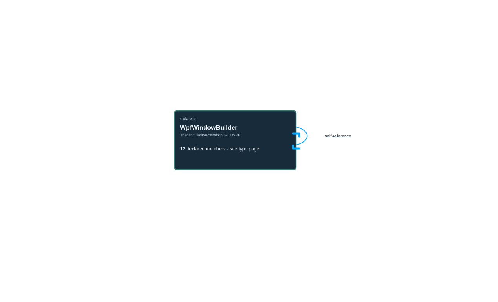

<!-- The Singularity Workshop moniker -->

# TheSingularityWorkshop.GUI.WPF.WpfWindowBuilder

> Generated from compiler-backed source analysis. Do not edit by hand.

- Repository: `TrentBest/TheSingularityWorkshop.GUI`
- Revision: [`d01597026d83f798e62a2a144bfd9400a3cd44a8`](https://github.com/TrentBest/TheSingularityWorkshop.GUI/tree/d01597026d83f798e62a2a144bfd9400a3cd44a8)
- Project: `src/WPF/TheSingularityWorkshop.GUI.WPF.csproj`
- Type ID: `type:TheSingularityWorkshop.GUI.WPF, Version=0.1.0.0, Culture=neutral, PublicKeyToken=null:global::TheSingularityWorkshop.GUI.WPF.WpfWindowBuilder`
- Metadata name: `WpfWindowBuilder`
- Kind: `class`
- Generic arity: 0

## UML diagram

## Source declarations

- [`src/WPF/WpfWindowBuilder.cs:11-118`](https://github.com/TrentBest/TheSingularityWorkshop.GUI/blob/d01597026d83f798e62a2a144bfd9400a3cd44a8/src/WPF/WpfWindowBuilder.cs#L11-118)

## Members

| Kind | Signature | Source |
|---|---|---|
| `Method` | `TheSingularityWorkshop.GUI.WPF.WpfWindowBuilder.Build()` | [`src/WPF/WpfWindowBuilder.cs:117-117`](https://github.com/TrentBest/TheSingularityWorkshop.GUI/blob/d01597026d83f798e62a2a144bfd9400a3cd44a8/src/WPF/WpfWindowBuilder.cs#L117-117) |
| `Method` | `TheSingularityWorkshop.GUI.WPF.WpfWindowBuilder.OwnedBy(System.Windows.Window)` | [`src/WPF/WpfWindowBuilder.cs:53-57`](https://github.com/TrentBest/TheSingularityWorkshop.GUI/blob/d01597026d83f798e62a2a144bfd9400a3cd44a8/src/WPF/WpfWindowBuilder.cs#L53-57) |
| `Method` | `TheSingularityWorkshop.GUI.WPF.WpfWindowBuilder.ShowInTaskbar(bool)` | [`src/WPF/WpfWindowBuilder.cs:109-113`](https://github.com/TrentBest/TheSingularityWorkshop.GUI/blob/d01597026d83f798e62a2a144bfd9400a3cd44a8/src/WPF/WpfWindowBuilder.cs#L109-113) |
| `Method` | `TheSingularityWorkshop.GUI.WPF.WpfWindowBuilder.WithBackground(System.Windows.Media.Brush)` | [`src/WPF/WpfWindowBuilder.cs:90-94`](https://github.com/TrentBest/TheSingularityWorkshop.GUI/blob/d01597026d83f798e62a2a144bfd9400a3cd44a8/src/WPF/WpfWindowBuilder.cs#L90-94) |
| `Method` | `TheSingularityWorkshop.GUI.WPF.WpfWindowBuilder.WithContent(System.Windows.FrameworkElement)` | [`src/WPF/WpfWindowBuilder.cs:46-50`](https://github.com/TrentBest/TheSingularityWorkshop.GUI/blob/d01597026d83f798e62a2a144bfd9400a3cd44a8/src/WPF/WpfWindowBuilder.cs#L46-50) |
| `Method` | `TheSingularityWorkshop.GUI.WPF.WpfWindowBuilder.WithIcon(System.Windows.Media.ImageSource)` | [`src/WPF/WpfWindowBuilder.cs:100-104`](https://github.com/TrentBest/TheSingularityWorkshop.GUI/blob/d01597026d83f798e62a2a144bfd9400a3cd44a8/src/WPF/WpfWindowBuilder.cs#L100-104) |
| `Method` | `TheSingularityWorkshop.GUI.WPF.WpfWindowBuilder.WithResizeMode(System.Windows.ResizeMode)` | [`src/WPF/WpfWindowBuilder.cs:71-75`](https://github.com/TrentBest/TheSingularityWorkshop.GUI/blob/d01597026d83f798e62a2a144bfd9400a3cd44a8/src/WPF/WpfWindowBuilder.cs#L71-75) |
| `Method` | `TheSingularityWorkshop.GUI.WPF.WpfWindowBuilder.WithSize(double, double)` | [`src/WPF/WpfWindowBuilder.cs:32-43`](https://github.com/TrentBest/TheSingularityWorkshop.GUI/blob/d01597026d83f798e62a2a144bfd9400a3cd44a8/src/WPF/WpfWindowBuilder.cs#L32-43) |
| `Method` | `TheSingularityWorkshop.GUI.WPF.WpfWindowBuilder.WithStartupLocation(System.Windows.WindowStartupLocation)` | [`src/WPF/WpfWindowBuilder.cs:62-66`](https://github.com/TrentBest/TheSingularityWorkshop.GUI/blob/d01597026d83f798e62a2a144bfd9400a3cd44a8/src/WPF/WpfWindowBuilder.cs#L62-66) |
| `Method` | `TheSingularityWorkshop.GUI.WPF.WpfWindowBuilder.WithTitle(string)` | [`src/WPF/WpfWindowBuilder.cs:25-29`](https://github.com/TrentBest/TheSingularityWorkshop.GUI/blob/d01597026d83f798e62a2a144bfd9400a3cd44a8/src/WPF/WpfWindowBuilder.cs#L25-29) |
| `Method` | `TheSingularityWorkshop.GUI.WPF.WpfWindowBuilder.WithWindowStyle(System.Windows.WindowStyle)` | [`src/WPF/WpfWindowBuilder.cs:80-84`](https://github.com/TrentBest/TheSingularityWorkshop.GUI/blob/d01597026d83f798e62a2a144bfd9400a3cd44a8/src/WPF/WpfWindowBuilder.cs#L80-84) |
| `Field` | `TheSingularityWorkshop.GUI.WPF.WpfWindowBuilder._window` | [`src/WPF/WpfWindowBuilder.cs:13-22`](https://github.com/TrentBest/TheSingularityWorkshop.GUI/blob/d01597026d83f798e62a2a144bfd9400a3cd44a8/src/WPF/WpfWindowBuilder.cs#L13-22) |

## Relationships

| Direction | Kind | Related type | Resolution | Evidence |
|---|---|---|---|---|
| outgoing | `Dependency` | `TheSingularityWorkshop.GUI.WPF.WpfWindowBuilder` | `Resolved` | [`src/WPF/WpfWindowBuilder.cs:53-57`](https://github.com/TrentBest/TheSingularityWorkshop.GUI/blob/d01597026d83f798e62a2a144bfd9400a3cd44a8/src/WPF/WpfWindowBuilder.cs#L53-57) |
| outgoing | `Dependency` | `TheSingularityWorkshop.GUI.WPF.WpfWindowBuilder` | `Resolved` | [`src/WPF/WpfWindowBuilder.cs:109-113`](https://github.com/TrentBest/TheSingularityWorkshop.GUI/blob/d01597026d83f798e62a2a144bfd9400a3cd44a8/src/WPF/WpfWindowBuilder.cs#L109-113) |
| outgoing | `Dependency` | `TheSingularityWorkshop.GUI.WPF.WpfWindowBuilder` | `Resolved` | [`src/WPF/WpfWindowBuilder.cs:90-94`](https://github.com/TrentBest/TheSingularityWorkshop.GUI/blob/d01597026d83f798e62a2a144bfd9400a3cd44a8/src/WPF/WpfWindowBuilder.cs#L90-94) |
| outgoing | `Dependency` | `TheSingularityWorkshop.GUI.WPF.WpfWindowBuilder` | `Resolved` | [`src/WPF/WpfWindowBuilder.cs:46-50`](https://github.com/TrentBest/TheSingularityWorkshop.GUI/blob/d01597026d83f798e62a2a144bfd9400a3cd44a8/src/WPF/WpfWindowBuilder.cs#L46-50) |
| outgoing | `Dependency` | `TheSingularityWorkshop.GUI.WPF.WpfWindowBuilder` | `Resolved` | [`src/WPF/WpfWindowBuilder.cs:100-104`](https://github.com/TrentBest/TheSingularityWorkshop.GUI/blob/d01597026d83f798e62a2a144bfd9400a3cd44a8/src/WPF/WpfWindowBuilder.cs#L100-104) |
| outgoing | `Dependency` | `TheSingularityWorkshop.GUI.WPF.WpfWindowBuilder` | `Resolved` | [`src/WPF/WpfWindowBuilder.cs:71-75`](https://github.com/TrentBest/TheSingularityWorkshop.GUI/blob/d01597026d83f798e62a2a144bfd9400a3cd44a8/src/WPF/WpfWindowBuilder.cs#L71-75) |
| outgoing | `Dependency` | `TheSingularityWorkshop.GUI.WPF.WpfWindowBuilder` | `Resolved` | [`src/WPF/WpfWindowBuilder.cs:32-43`](https://github.com/TrentBest/TheSingularityWorkshop.GUI/blob/d01597026d83f798e62a2a144bfd9400a3cd44a8/src/WPF/WpfWindowBuilder.cs#L32-43) |
| outgoing | `Dependency` | `TheSingularityWorkshop.GUI.WPF.WpfWindowBuilder` | `Resolved` | [`src/WPF/WpfWindowBuilder.cs:62-66`](https://github.com/TrentBest/TheSingularityWorkshop.GUI/blob/d01597026d83f798e62a2a144bfd9400a3cd44a8/src/WPF/WpfWindowBuilder.cs#L62-66) |
| outgoing | `Dependency` | `TheSingularityWorkshop.GUI.WPF.WpfWindowBuilder` | `Resolved` | [`src/WPF/WpfWindowBuilder.cs:25-29`](https://github.com/TrentBest/TheSingularityWorkshop.GUI/blob/d01597026d83f798e62a2a144bfd9400a3cd44a8/src/WPF/WpfWindowBuilder.cs#L25-29) |
| outgoing | `Dependency` | `TheSingularityWorkshop.GUI.WPF.WpfWindowBuilder` | `Resolved` | [`src/WPF/WpfWindowBuilder.cs:80-84`](https://github.com/TrentBest/TheSingularityWorkshop.GUI/blob/d01597026d83f798e62a2a144bfd9400a3cd44a8/src/WPF/WpfWindowBuilder.cs#L80-84) |

[Back to the generated type index](index.md)

---

<!-- THE SINGULARITY WORKSHOP FOOTER -->

