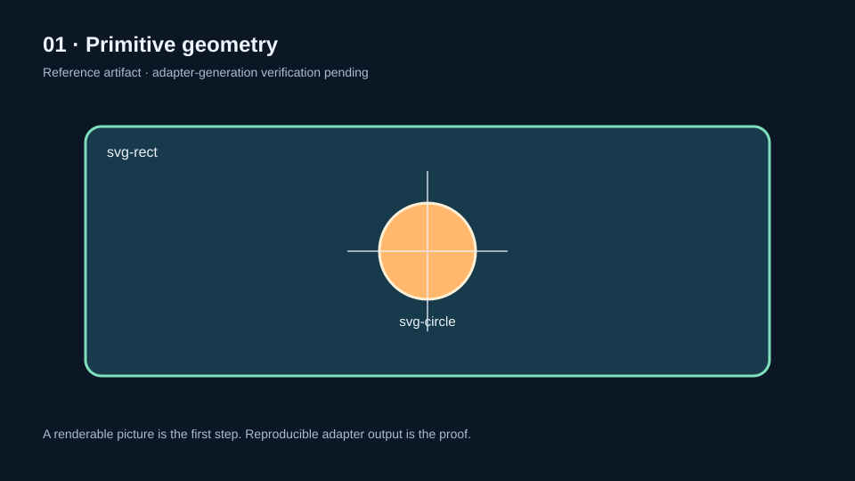
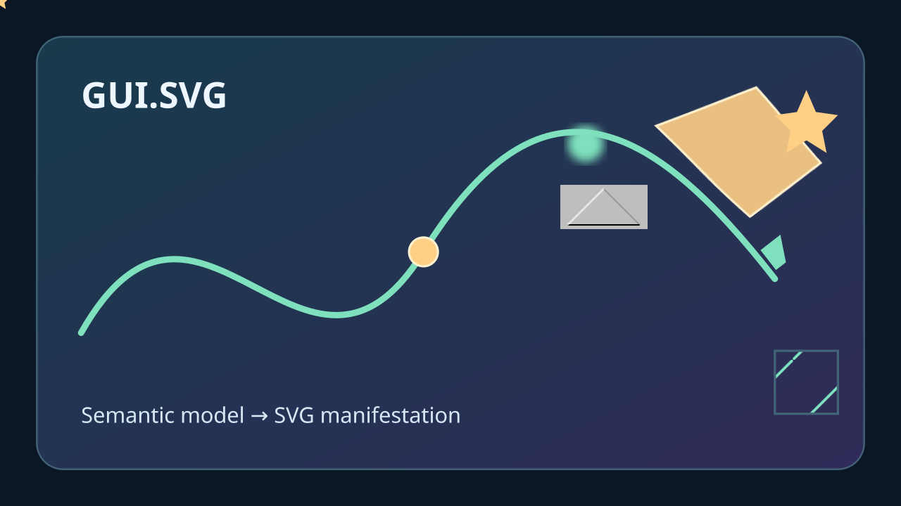

# GUI.SVG Recipes

A visual index organized by the packages and repositories each example actually uses. Each entry has a two-sentence summary and one link to its full walkthrough or source.

## GUI.SVG only

### Recipe 01 — Primitive geometry

Define a small semantic `GuiNode` tree and turn it into inspectable SVG markup with GUI.SVG. The first generated artifact passed basic XML checks but visual review found the panel clipped by the viewBox; the generator now corrects the geometry and checks stroke-aware bounds, pending a fresh CI artifact review.

[**Read Recipe 01 — Primitive geometry**](recipes/01-primitive-geometry.md)

### Recipe 02 — Cartesian coordinates and f(x) = x²

The generator builds a Cartesian coordinate system and computes 33 samples from the function before handing the semantic scene to GUI.SVG. The artifact from [workflow run 39452760590](https://github.com/TrentBest/TheSingularityWorkshop.GUI/actions/runs/39452760590) was visually reviewed; that review found formula/curve overlap, the legend was moved to the right, and the revised SVG generation and structural checks passed CI.

[**Read Recipe 02 — Cartesian coordinates and sampled function**](recipes/02-coordinate-functions.md)

### Recipe 04 — Animated scene

Explore reusable SVG definitions, filters, and declarative animation, including a filled star moving along a referenced path. The animation is interpreted by a compatible SVG viewer; it is not an FSM_API clock or proof of GPU rendering.

[**Read Recipe 04 — Animated scene**](recipes/04-animated-scene.md)

## GUI Core + GUI.SVG + Physics run data

### Recipe 03 — Projectile trajectory from a recorded Physics run

The generator consumes the Physics-owned JSON run record at a pinned source commit, then renders its recorded X/Z positions through GUI Core and the actual GUI.SVG adapter. [The full workflow passed and uploaded the generated SVG artifact](https://github.com/TrentBest/TheSingularityWorkshop.GUI/actions/runs/39453243758/artifacts/12277859868); visual review confirmed the nine plotted state markers match the input record.

[**Read Recipe 03 — Physics-backed projectile trajectory**](recipes/03-projectile-trajectory.md)

## Harvested from TheSingularityWorkshop.Physics

These SVGs remain owned by Physics; this gallery links to the source rather than copying or implying GUI.SVG generated them. They are candidates for richer step-by-step lessons once their equations, data, and run records are connected to the displayed progression.

### Spring and damper

A spring-damper system is a natural bridge from a formula to visible motion and changing system state. The source repository owns the illustration and its underlying lesson.

[**Open the Physics source**](https://github.com/TrentBest/TheSingularityWorkshop.Physics/blob/development/docs/images/spring-damper-living.svg)

### Lookup-table interpolation

Interpolation can be taught by showing sample points, the interval being evaluated, and the changing estimate between known values. This is a harvested Physics illustration, not yet a GUI.SVG-generated scene.

[**Open the Physics source**](https://github.com/TrentBest/TheSingularityWorkshop.Physics/blob/development/docs/images/lookup-table-interpolation.svg)

### Projectile trajectory

A projectile lesson can progress from initial conditions to trajectory, then compare how changing a parameter changes the path. The Physics repository retains the authoritative illustration, lesson, and run record.

[**Open the Physics experiment**](https://github.com/TrentBest/TheSingularityWorkshop.Physics/blob/development/docs/experiments/projectile-trajectory.md)

## Harvested from TheSingularityWorkshop.Visualize

### Primitive gallery: connected points

This artifact belongs to Visualize's primitive gallery and demonstrates a GUI.SVG proof output in that consuming repository. The linked source preserves its generation context and the boundary between an SVG proof and Visualize's own rendering path.

[**Open the Visualize gallery**](https://github.com/TrentBest/TheSingularityWorkshop.Visualize/tree/development/samples/PrimitiveGallery)

---

[Demonstration roadmap and evidence policy](README.md) · [SVG adapter contract](../../docs/SVG_ADAPTER.md)
