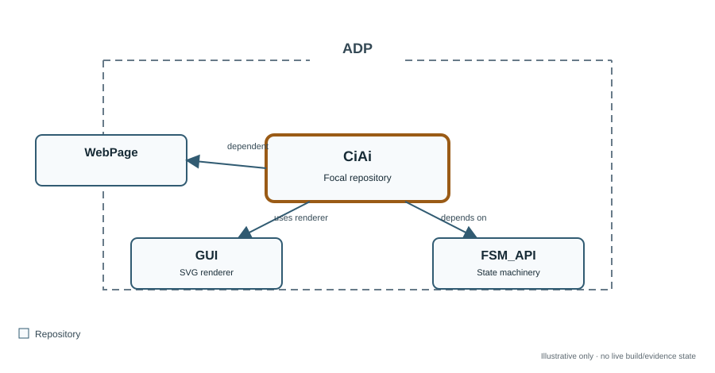

# Directed graph renderer — gallery example

This static gallery plate illustrates the generic GUI.SVG contract: repository-shaped nodes, directed arrows, a centered focal repository, and an explicit dashed cluster whose title interrupts the top border. The production renderer generates standalone accessible SVG from `SvgDirectedGraph`; consumers provide graph meaning and membership.

See [Directed graph SVG renderer](../../docs/SVG_DIRECTED_GRAPHS.md) for the contract, C# example, bounds, and ownership rules.

**What this proves:** the intended visual vocabulary and reading order.

**What this does not prove:** that a live CiAi graph, complete ecosystem inventory, build state, or Pages integration exists. The graph is illustrative, not runtime evidence.
