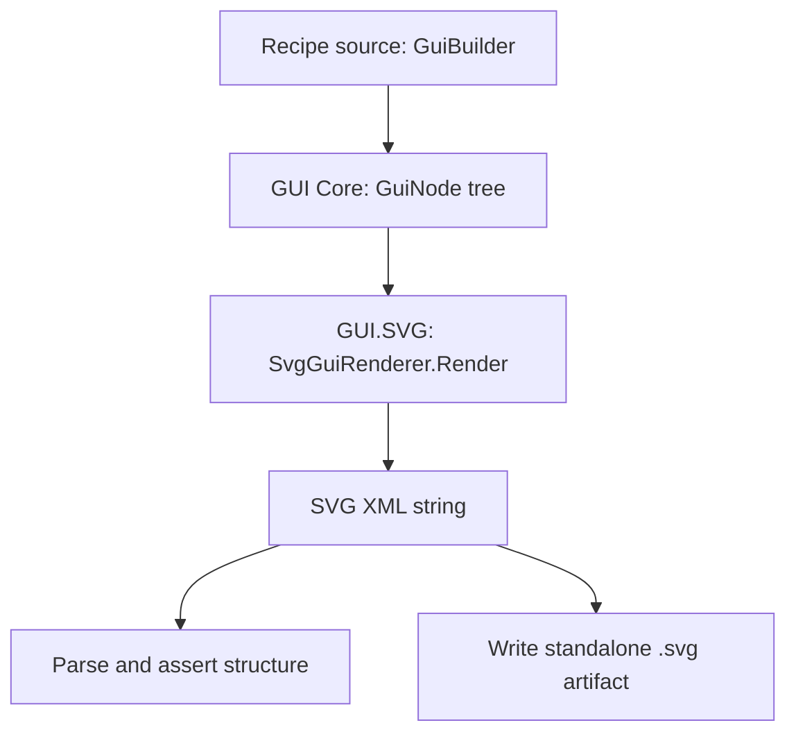
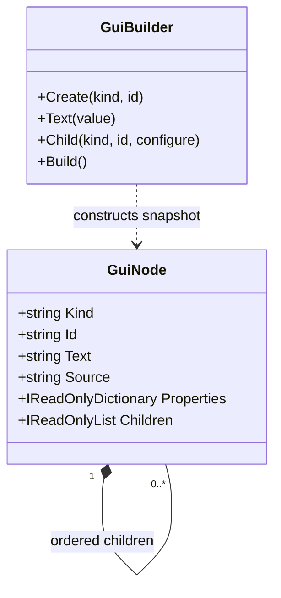

# Recipe 01 — Primitive geometry: from model to SVG

This is the implementation companion to the [GUI.SVG Recipes Gallery](../GALLERY.md#recipe-01--primitive-geometry). The gallery is the quick visual explanation; this page follows the entire current path behind the result.

## 1. Boundary map



This recipe consumes the **GUI Core** and **GUI.SVG** source projects through project references. It does not consume the separate Renderer or Visualize NuGet packages. Those belong in a later, separately verified integration recipe.

## 2. Data model / UML view

The sample's data shape is intentionally small. It uses the repository's real immutable `GuiNode` model rather than inventing a second scene class.



A node has a kind, stable ID, optional text/source, string-valued properties, and ordered child nodes. The tree is the semantic input to the adapter. SVG tag names and SVG serialization are the adapter's responsibility.

Source: [`GuiNode.cs`](../../../src/Core/GuiNode.cs), [`GuiBuilder.cs`](../../../src/Core/GuiBuilder.cs).

## 3. The textual scene recipe

The actual checked-in generator constructs a root scene with a rounded rectangle and a circle:

```csharp
var scene = GuiBuilder.Create("svg-scene", "scene")
    .Text("GUI.SVG demonstration 01: primitive geometry")
    .Child("svg-rect", "panel", panel => panel
        .Property("x", "10").Property("y", "5")
        .Property("width", "80").Property("height", "46")
        .Property("rx", "5")
        .Property("fill", "#173b4c")
        .Property("stroke", "#7ee0bd")
        .Property("stroke-width", "2"))
    .Child("svg-circle", "marker", marker => marker
        .Property("cx", "50").Property("cy", "28")
        .Property("r", "8")
        .Property("fill", "#ffb86c"))
    .Build();
```

This is the human-reviewable scene description. It is not raw SVG and it does not depend on browser DOM types. The stable IDs `panel` and `marker` provide handles for structural checks.

Source of truth: [`Program.cs`](../PrimitiveGeometry/Program.cs).

## 4. The adapter step

```csharp
var svg = new SvgGuiRenderer().Render(scene, width: 960, height: 540);
```

The SVG adapter reads the `GuiNode` snapshot, maps supported node kinds to SVG elements, serializes an SVG document, and returns the markup as a string. In this sample, the rectangle and circle nodes become SVG `rect` and `circle` elements. The adapter owns the SVG namespace and element serialization; Core does not need SVG-specific types.

Source: [`SvgGuiRenderer.cs`](../../../src/SVG/SvgGuiRenderer.cs), [adapter contract](../../../docs/SVG_ADAPTER.md).

## 5. Verification and artifact output

The generator parses the returned string as XML and checks:
- the document root is an SVG element in the SVG namespace;
- a rectangle with ID `panel` exists;
- a circle with ID `marker` exists;
- the panel stroke fits completely inside the SVG `viewBox`, so the panel is not clipped by the viewport.

It then writes the generated SVG to a caller-specified path, or to `01-primitive-geometry.generated.svg` in the current directory.

From the repository root:

```bash
dotnet run --project samples/demonstrations/PrimitiveGeometry/PrimitiveGeometry.csproj -- samples/demonstrations/01-primitive-geometry.generated.svg
```

A successful execution should print `PASS` and the output path. The generator and workflow now check the panel's stroke-aware bounds against the SVG viewBox. A prior artifact exposed a clipped panel despite passing the initial structural checks; the panel dimensions and marker position have been corrected, and the stronger bounds assertion is now part of the verification. The corrective workflow run is pending; do not consider the visual correction complete until its artifact has been inspected. Keep the generated file distinct from the hand-authored reference SVG.

Project: [`PrimitiveGeometry.csproj`](../PrimitiveGeometry/PrimitiveGeometry.csproj).

## 6. What this recipe establishes

| Claim | Evidence in this recipe | Status |
|---|---|---|
| Core can describe the scene as a recursive node tree | Actual `GuiBuilder` source and `GuiNode` implementation | Source inspected |
| SVG adapter consumes the tree and emits SVG XML | Actual `SvgGuiRenderer.Render` call and implementation | Source inspected; execution must be recorded |
| Output has the required panel and marker | XML assertions in generator | Assertion code exists; passing run not claimed |
| Browser can render the generated SVG | Standalone SVG format | Viewer execution not recorded here |
| Renderer NuGet package consumes this model | Not part of this recipe | Not demonstrated |
| Visualize package produces the visible output | Not part of this recipe | Not demonstrated |
| FSM_API runtime state drives the marker | No state-machine execution in this recipe | Not demonstrated |

## 7. How the recipe grows into the full stack

The intended progression is not to label every picture “rendered.” It is to add independently verifiable links:

1. **Data/UML:** define the data contract and show the relationship diagram.
2. **Textual scene:** translate the data into a human-reviewable scene description.
3. **Renderer:** consume that description using the actual Renderer package API.
4. **Visualize:** hand the resulting scene or render description to the actual Visualize API.
5. **State and behavior:** when appropriate, show how FSM_API transitions alter the data/scene, with a trace connecting a transition to the changed manifestation.
6. **GUI.SVG companion:** emit an inspectable SVG snapshot of the same semantic scene when useful for documentation and regression tests.

Before implementing that next recipe, inspect the Renderer and Visualize repositories and pin their real package APIs. Do not fabricate a convenient API shape for the sake of a diagram.

## Acceptance criteria

- [ ] Run the project against the current source and record a passing result.
- [ ] Review and link the generated SVG, separate from the reference illustration.
- [ ] Assert text and any other required elements if the sample adds them.
- [ ] Keep package dependency claims aligned with project references.
- [ ] Add the next recipe only when its source, output, and verification are reproducible.
