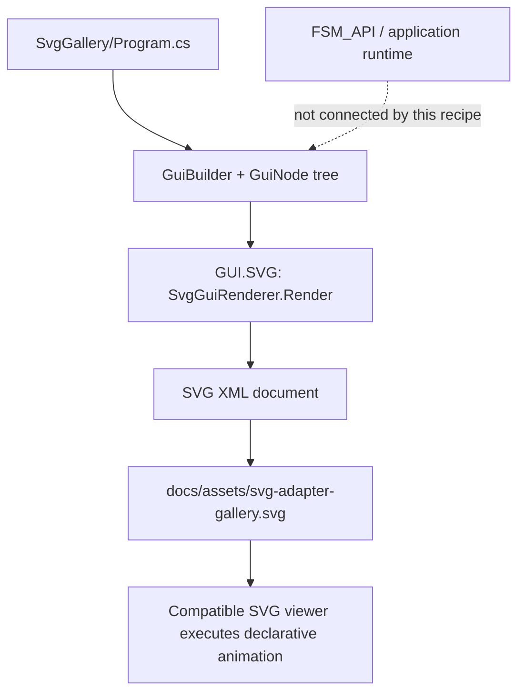

# Recipe 04 — Animated scene: reusable SVG and motion paths

This is the implementation walkthrough for the [GUI.SVG Recipes Gallery](../GALLERY.md#recipe-04--animated-scene). It follows the animated gallery from the semantic builder, through the SVG adapter, to the committed SVG artifact—and distinguishes declarative viewer animation from application runtime behavior.

## 1. What this recipe demonstrates

The scene combines reusable definitions and presentation features in one SVG document:

- a gradient-backed panel, clipping path, pattern, arrow marker, and filter definitions;
- a reusable filled-star symbol referenced in two places;
- a pulsing circle using `svg-animate` and `svg-set`;
- a filled star moving along a reusable path through `svg-animate-motion` and `svg-mpath`;
- accessible title/description metadata and a navigable SVG link.

The moving scout is a filled star rather than a tiny dot so the moving entity remains visually legible.

## 2. Boundary map



This recipe uses GUI Core and GUI.SVG through the repository's source project references. It does not demonstrate a Renderer NuGet or Visualize GPU pipeline, and it does not bind animation progress to FSM_API or FSM_COS.

## 3. The reusable star

The builder defines a named symbol in `svg-defs`:

```csharp
.Child("svg-symbol", "star-symbol", symbol => symbol.Property("viewBox", "0 0 10 10")
    .Child("svg-polygon", "star-shape", polygon => polygon
        .Property("points", "5,0 6.5,3.5 10,4 7.5,6.5 8.2,10 5,8 1.8,10 2.5,6.5 0,4 3.5,3.5")
        .Property("fill", "#ffcf86")))
```

A static instance reuses it with `svg-use`. The moving instance also references that symbol, then nests an explicit motion animation:

```csharp
scene.Child("svg-use", "motion-scout", scout => scout
    .Property("href", "#star-symbol")
    .Property("x", "-1").Property("y", "-1")
    .Property("width", "2").Property("height", "2")
    .Child("svg-animate-motion", "scout-motion", motion => motion
        .Property("dur", "5s")
        .Property("repeatCount", "indefinite")
        .Property("rotate", "auto")
        .Child("svg-mpath", "scout-route-reference",
            reference => reference.Property("href", "#orbit-path"))));
```

The motion path itself is named `orbit-path` in the reusable definitions. That identity makes the route a distinct scene element rather than embedding path geometry into the animation node.

Source: [`Program.cs`](../../SvgGallery/Program.cs).

## 4. From semantic tree to SVG

The sample calls the real adapter:

```csharp
var svg = new SvgGuiRenderer().Render(scene.Build(), width: 1280, height: 720);
Directory.CreateDirectory(Path.GetDirectoryName(output)!);
File.WriteAllText(output, svg);
```

The adapter serializes the tree into SVG XML. The viewer—not GUI.SVG itself—interprets supported declarative SVG animation instructions. The adapter does not run a timer, invoke FSM transitions, or decide where the star should move based on live application state.

Implementation: [`SvgGuiRenderer.cs`](../../../src/SVG/SvgGuiRenderer.cs) · [adapter contract](../../../docs/SVG_ADAPTER.md).

## 5. Regenerate and verify

From the repository root:

```sh
dotnet run --project samples/SvgGallery/SvgGallery.csproj --configuration Release
dotnet test tests/SVG.Tests/TheSingularityWorkshop.GUI.SVG.Tests.csproj --configuration Release
```

The first command writes `docs/assets/svg-adapter-gallery.svg` by default. Review the resulting diff; the generated artifact should be committed with intentional source changes. The SVG adapter documentation says CI regenerates this file and compares it byte-for-byte with the snapshot.

Representative test coverage includes reusable symbols, patterns, markers and filter primitives, plus explicit SVG animation and transform nodes. See the [gallery-to-test map](../../../docs/SVG_ADAPTER.md#gallery-to-test-map).

**Verification status for this documentation change:** source and the committed SVG were inspected, but the generator and tests have not been executed in this work step. Do not treat this walkthrough as a fresh passing build record.

## 6. Evidence boundaries

| Claim | What supports it | What it does not establish |
|---|---|---|
| A semantic GUI model can describe this scene | Builder code and `GuiNode` tree | Runtime behavior |
| GUI.SVG can serialize supported nodes into SVG | Actual `SvgGuiRenderer.Render` call and adapter implementation | GPU rendering |
| The SVG describes a moving star | Reusable symbol, referenced path, and `animateMotion` markup | That the committed artifact matches current source until regeneration is checked |
| A compatible viewer may animate the star | Declarative SVG animation in the document | Identical playback in every viewer |
| FSM_API drives the star | No FSM_API execution or state-to-scene bridge exists here | Not demonstrated |
| Renderer / Visualize produce this artifact | They are not the source projects used by this sample | Not demonstrated |

## 7. How to extend the recipe

A stronger behavior recipe should connect real runtime state to the visible manifestation:

1. define the domain data and show its UML/data contract;
2. create a human-reviewable textual scene description from that data;
3. use the actual Renderer API and package reference in a runnable consumer;
4. connect FSM_API state transitions to changes in scene data, and record the trace;
5. use the actual Visualize package for its own manifestation path;
6. retain GUI.SVG as an inspectable companion artifact where useful.

Inspect the consuming repositories for their actual APIs before implementing this chain. GUI.SVG is a useful evidence surface, but it must not silently stand in for Renderer or Visualize.

## Acceptance checklist

- [ ] Regenerate the SVG from the current source.
- [ ] Confirm the moving scout is emitted as a reusable filled-star instance, not a circle.
- [ ] Run the SVG adapter test suite and record the result.
- [ ] Review the generated artifact diff and commit it with the source.
- [ ] Keep runtime/FSM_API and Renderer/Visualize claims separate until each has a runnable proof.
