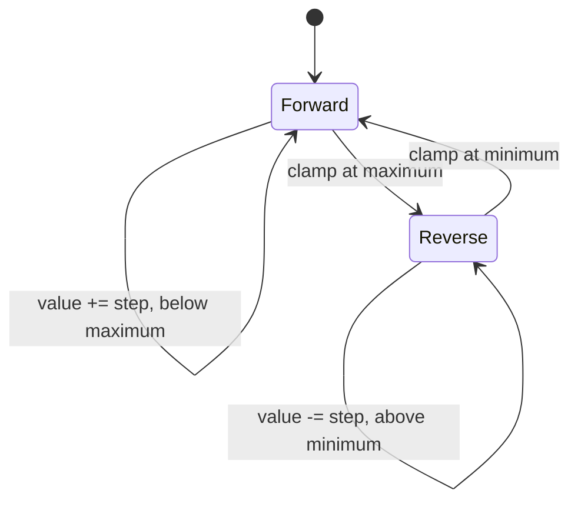

<!-- The Singularity Workshop moniker -->
<p align="center"><a href="https://github.com/TrentBest"></a></p>

# Recipe 07 — FSM-driven bounded oscillator

> A value reaches the end of its range, turns around, and comes back. No teleportation. No mysterious reset. Just a state machine doing exactly what we told it to do.

**Status: runnable sample added; end-to-end verification pending.** The sample now defines real FSM_API states, advances them through the API's processing loop, and passes the resulting state to GUI Core / GUI.SVG. CI must still build and run the sample, and the generated artifact needs visual review before this is called a verified proof.

## What you should see

A function is defined over a bounded input range:

\[ x_{min} \leq x \leq x_{max}, \qquad y = f(x) \]

This example plots \(y=\sin(x)\) over \(0\leq x\leq10\). The marker represents the latest value reported by the FSM. The sample uses a step of 3, so the trace runs through 3, 6, 9, 10, 7, 4, 1, 0, then repeats. The final SVG is a **snapshot** at the last verified step, not a browser animation.

## Run it

From the repository root:

```sh
dotnet run --project samples/demonstrations/FsmDrivenOscillator/FsmDrivenOscillator.csproj
```

Optionally pass an explicit output path:

```sh
dotnet run --project samples/demonstrations/FsmDrivenOscillator/FsmDrivenOscillator.csproj -- ./artifacts/oscillator.svg
```

The project references the published `TheSingularityWorkshop.FSM_API` package and the local GUI Core / GUI.SVG projects. It intentionally has no Unity reference.

## The state machine



FSM_API owns the movement. Each explicit processing-group update advances the active state's context and then evaluates the transition guards. The host reads the context and current state; the SVG renderer does not make movement decisions.

## Boundary behavior

- Bounds must be finite, with `Minimum < Maximum`.
- Step magnitude must be finite and greater than zero.
- Each proposed value is clamped to the endpoint; the FSM changes direction on that same tick.
- A step that is larger than the entire range still reaches an endpoint and reverses; it does not wrap or reset.
- The curve samples and marker coordinates are generated from the same function definition. The displayed marker is derived from the final FSM context value.

## What the sample checks

The executable fails if its expected twelve-step trace differs, if the oversized-step case fails to reverse at both endpoints, if invalid bounds or step magnitudes are accepted, or if the generated XML lacks the curve or marker. It prints the trace and writes `07-fsm-driven-oscillator.generated.svg` by default.

These are executable self-checks in the sample, not a separate unit-test project. A successful run and a visual artifact review are still required before the recipe can be labeled fully verified.

## Architecture and limits

```mermaid
flowchart TD
    T[Explicit host tick] --> F[FSM_API state machine]
    F --> S[Current value and direction]
    S --> M[Evaluate y = sin(x)]
    M --> D[Semantic scene data]
    D --> G[GUI Core]
    G --> V[GUI.SVG renderer]
    V --> A[Generated SVG snapshot]
    A --> H[Host displays or archives snapshot]
```

The existing SVG adapter serializes a semantic scene; it does not own a timer or maintain live application state. A live viewer would need a host loop that repeatedly advances the FSM and redraws or replaces the SVG. Declarative SVG animation alone would not prove that FSM_API drove the motion.

Related reading:

- [GUI.SVG adapter contract](../../../docs/SVG_ADAPTER.md)
- [Recipe 02 — function transformations](02-coordinate-functions.md)
- [Recipe 04 — declarative SVG animation](04-animated-scene.md)
- [Demonstration roadmap and evidence policy](../README.md)

## The bigger idea

Show the concept first, explain the implementation second, and state the evidence boundary plainly. If a picture is worth a thousand words, a picture whose state changes for a reason is worth even more.

---

<!-- THE SINGULARITY WORKSHOP FOOTER -->
<p align="center"></p>
